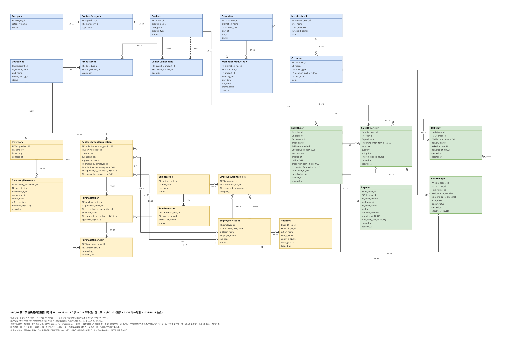
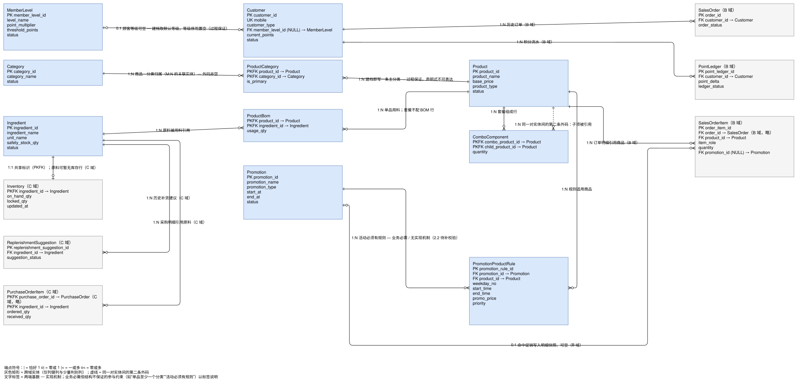

# KFC-DB

以现实 KFC 为原型的门店经营数据库课程设计项目，贯穿 17 周共 4 个阶段，让同一套库从"记录业务"逐步建设为"支持经营分析与补货决策的应用"。

## 项目范围

覆盖门店从后台准备到补货闭环的完整经营链路，按业务主线分层建设：商品/BOM/促销等主数据、订单与支付、积分两段式、防超卖库存、补货建议与采购入库，以及后续的经营分析视角。**第一阶段关系数据库交付已完成**：可从空库一次部署表、约束、过程、视图、种子和岗位权限，并执行 A/B/C 三域验收。**第二阶段正在进行**：ER 模型重建（2.1）的四类交付物已齐——三域子图与合并总图（25 实体 / 35 外键）、三域规范化分析、问题清单、A 的命名与情形验证，「数据库设计」一节五项已补全；迁移（2.2）与应用开发（2.3）尚未开工。

## 目录结构

```text
KFC-DB/
├── README.md                    本文件：项目范围、业务角色、环境、复现步骤
├── .gitattributes               固定 result/*.txt 的换行，使登记的 SHA-256 可逐字节核对
├── sql/                         全部脚本（20 个），唯一入口 run_all.sql
│   ├── run_all.sql              按固定顺序 :r 串联其余脚本，需从仓库根目录执行
│   ├── 00_create_database.sql   建库；检测到同名库主动报错停止，不覆盖已有数据
│   ├── 01 / 02 / 03             三域建表：主数据、订单、库存与权限
│   ├── 04 / 05 / 06             三域约束与 CRUD 过程
│   ├── 07a / 07b / 07c          三域视图与关键查询
│   ├── 08_roles_permissions.sql 角色与最小授权
│   ├── 09a ~ 09d                三域种子数据
│   ├── 10a / 10b / 10c          三域验收断言
│   └── contract_interface_check.sql   只读跨域接口契约检查（独立执行）
├── docs/                        设计与验收文档（45 份：顶层 8 + stage1/ 7 + stage2/ 21 + er/ 9）
│   ├── stage2-three-person-implementation-plan.md  第二阶段计划与分工：ER 重建、规范化与迁移、应用开发，含 v0.1 问题清单
│   ├── 主数据 / 订单履约 / 库存权限数据字典.md      三份字段级数据字典
│   ├── 业务流程.md               业务主线 8 步（含异常路径）
│   ├── 数据边界清单.md           进库 / 不进库边界与灰色地带取舍
│   ├── 角色与职能清单.md         7 个业务角色的职责与映射
│   ├── AI使用记录.md             AI 协作过程记录
│   ├── stage1/                  第一阶段交付文档（7 份）
│   │   ├── 阶段报告.md           总报告：设计思路、实验过程、实验总结
│   │   ├── a / b / c-stage-report.md   三份成员分工报告
│   │   ├── test-report.md        完整测试报告：环境、结果、E2E 结论、三次独立复验
│   │   ├── cross-domain-interface-contract.md   A/B/C 之间冻结的接口契约
│   │   └── three-person-implementation-plan.md  第一阶段协作实施计划与分工总览
│   ├── stage2/                  第二阶段过程文档（21 份）
│   │   ├── source-requirements.md   教学要求核对：65 项逐条编号与落点
│   │   ├── open-issues.md           跨域开放问题：状态与决议的唯一入口
│   │   ├── application-contract.md  第二阶段跨域接口契约（草案，未冻结）
│   │   ├── a-* / b-* / c-*.md       三域问题清单、规范化分析、阶段报告与交接
│   │   ├── naming.md                命名口径：对象形状、表名与字典对照、5 条偏差登记
│   │   ├── business-rule-mapping.md 联系两端基数与实现机制的映射（B 主笔）
│   │   └── refactoring-design.md、transaction-boundaries.md  重构方案与事务边界
│   └── er/                      ER 图源文件与图例（9 份）
│       ├── legend.md                端点符号与画法口径
│       ├── a-master.drawio / .svg   主数据与定价域子图（16 实体 16 联系）
│       ├── b-order.drawio / .svg    订单与履约域子图（9 实体 10 联系）
│       ├── c-inventory-security.drawio / .svg   库存权限域子图（12 实体 14 联系）
│       └── stage2-model.drawio / .svg           合并总图（25 实体 35 联系，C 交付）
└── result/                      执行证据（57 个：顶层 31 + stage2/ 12 + stage2/scripts/ 14）
    ├── README.md                证据清单：逐文件说明与全部 SHA-256
    ├── stage1-full-test-*.txt   三台机器各自从空库整跑的完整原始输出
    ├── stage1-contract-check-*.txt      跨域接口契约检查输出
    ├── stage1-object-inventory-2026-10-01.txt   对象数量清点
    ├── stage1-receiving-*-c-2026-10-01.txt      收货链不变量与边界断言（成员 C）
    ├── stage1-regression-c-2026-10-01.txt       夹具链回归汇总（成员 C）
    ├── stage1-full-test-summary-2026-10-01.png  结果摘要图
    ├── stage1-a-*.png           19 张操作截图：建库、CRUD、关键查询、越权、非法数据、权限
    └── stage2/                  第二阶段证据：ER 复核、规范化校验、三机整跑原始输出
```

部署入口只有 `sql/run_all.sql` 一个。`docs/` 与 `result/` 不参与部署，分别是设计依据和执行证据。

## 业务角色

第一阶段落地 7 个业务角色，一律通过数据库角色授权，不向个人账号或业务角色开放任何表级写权限——所有业务写入只经存储过程完成。

| 角色 | 数据库角色名 | 职责 |
| --- | --- | --- |
| 店长 | `role_store_manager` | 主数据维护（商品、分类、BOM、套餐、促销、会员等级）、补货审批、角色分配 |
| 值班经理 | `role_shift_manager` | 库存与预警查看、补货建议提交、外送调度 |
| 收银员 | `role_cashier` | 下单与收款 |
| 厨师 | `role_chef` | 开始/完成制作 |
| 配餐员 | `role_packer` | 出餐、打包、取餐 |
| 骑手 | `role_rider` | 配送确认 |
| 服务员 | `role_waiter` | 只读 |

完整清单（含顾客侧角色与系统自动行为）见[角色与职能清单](docs/角色与职能清单.md)；权限的划分口径与正反例见[第一阶段阶段报告](docs/stage1/阶段报告.md) §1.6。

## 环境

- 数据库平台：SQL Server 2025（17.0，兼容级别不低于 130）
- 已验证实例（三台机器各自从空库整跑，结论一致）：`localhost\MSSQLSERVER2`（Developer Edition）、`.\SQLEXPRESS`（Express Edition）、`localhost`（`@@SERVERNAME` = `DESKTOP-TSLV34Q`，Express Edition）
- 登录方式：Windows 身份验证；部署账号需要建库权限
- 客户端：`sqlcmd`（ODBC Driver 18）或启用 SQLCMD Mode 的 SSMS

> 下文命令中的 `-S` 一律写作 `localhost\MSSQLSERVER2`；实际执行时换成自己的实例名即可，脚本与实例名无关。

## 整体链路

后台准备 → 顾客点餐计价 → 下单支付 → 后厨制作 → 交付配送 → 终态积分/库存处理 → 补货闭环

详细到每一步的状态迁移与数据写入见 [业务流程](docs/业务流程.md)。

## 数据库设计（第二阶段）

> 对应阶段作业要求的五项：ER 图、依赖分析、更新异常分析、范式分析、分解方案。本节只给结论与汇总表，逐表证据见各域分析文件。口径依据 v0.1（第一阶段交付版），v1.0 迁移完成后随 2.2 收口更新。

### ER 图

v0.1 的 25 张表还原为 **25 个实体、35 条物理外键**，按域拆成三张子图再合并为总图。端点只表达结构基数，业务上必需而结构不保证的约束写进联系标签（口径见 [ER 图例](docs/er/legend.md)）。

| 子图 | 实体 | 联系 | 文件 |
| --- | --- | --- | --- |
| 主数据与定价（A） | 16（10 本域 + 6 跨域灰实体） | 16 | [a-master.drawio](docs/er/a-master.drawio) / [.svg](docs/er/a-master.svg) |
| 订单与履约（B） | 9（5 本域 + 4 跨域灰实体） | 10 | [b-order.drawio](docs/er/b-order.drawio) / [.svg](docs/er/b-order.svg) |
| 库存权限（C） | 12（10 本域 + 2 跨域灰实体） | 14 | [c-inventory-security.drawio](docs/er/c-inventory-security.drawio) / [.svg](docs/er/c-inventory-security.svg) |
| 合并总图（C） | 25（A 10 / B 5 / C 10） | 35 | [stage2-model.drawio](docs/er/stage2-model.drawio) / [.svg](docs/er/stage2-model.svg) |



三张子图与本总图的对照已由 C 脚本核过：25 实体、35 条物理外键（A 9 / B 10 / C 16）全覆盖，联系标签带 `BR-01`–`BR-35` 业务规则编号，结构判据与几何判据 103 项 0 失败（证据 `result/stage2/stage2-model-check-2026-10-27.txt`）。



### 依赖分析

主数据域 10 张表的候选码与逐表函数依赖见 [a-normalization](docs/stage2/a-normalization.md) §2–§3。两处需要单独说明：

- **`MemberLevel.threshold_points` 是业务候选码，但只有过程在保证**：现有过程用 `WITH (UPDLOCK, HOLDLOCK)` 查重后抛 `51005`，没有声明式唯一约束。2.2 补 `UQ_MemberLevel_threshold_points`。
- **`Customer.current_points` 是「期初余额 + `PointLedger` 增量」**（PENDING 不计、EFFECTIVE 计一次、VOIDED 只能由 PENDING 转入），不是从零开始的流水加总——种子给两位顾客写了 500 / 1500 期初而没有对应流水。保留物化的口径与 `SalesOrder.total_amount` 相同：读多写少、只允许经过程写入，`08` 对该列已有列级 `DENY`。

库存权限域 10 张表的候选码与函数依赖见 [c-normalization](docs/stage2/c-normalization.md) §2–§3，两处容易读错：**`job_code` 与 `BusinessRole.role_code` 不是同一件事**（前者是员工岗位，后者是业务角色字典，映射由过程白名单保证），**可售量、未收数量、低库存布尔值都不落列**（视图现算，避免「两处数量必须同步」）——派生值一旦物化就多出一个必须手工维护的事实。

| 域 | 候选码现状 | 结论 | 证据 |
| --- | --- | --- | --- |
| 主数据 | 10 个主键（3 个复合）、1 个 `UNIQUE`、1 个过滤唯一索引；6 张表无声明式候选码（4 张业务唯一未声明、2 张无自然键） | 2.2 补 5 个唯一约束；`Promotion` / `PromotionProductRule` 不补 | [a-normalization](docs/stage2/a-normalization.md) §4.6 |
| 订单 | 5 个单列主码；4 个非空唯一约束，另有可空的取餐码过滤唯一；14 个 `CHECK`；`SalesOrder.order_no` 也是候选码，`Payment` / `Delivery` / `PointLedger` 各有 `(order_id)` 候选码 | 见 [b-normalization](docs/stage2/b-normalization.md)：`(order_id, product_id)` 不唯一，不构成候选码 | [b-normalization](docs/stage2/b-normalization.md) |
| 库存权限 | 10 个主键（3 个复合）、4 个 `UNIQUE`、1 个过滤唯一索引；`PurchaseOrder.replenishment_suggestion_id` 是业务候选码但未声明 | 2.2 补 1 个唯一约束（`UQ_PurchaseOrder_replenishment_suggestion_id`）；`RolePermission` 的复合码含部分依赖，另行拆分（`Permission` + 映射）；其余 8 表不动 | [c-normalization](docs/stage2/c-normalization.md) §4、§5.6 |

### 更新异常分析

逐表按插入 / 修改 / 删除三类检查。主数据域 10 张表**均不存在更新异常**：单属性代理键决定其余列，3 张全码关联表无部分依赖，没有需要冗余维护的非码属性。容易被误判为冗余的四处，已用种子数据反例证明是互异事实而非冗余：

| 疑似冗余 | 反例 | 实际语义 |
| --- | --- | --- |
| 一个商品只属一个分类 | 商品 3（薯条）同属分类 2（主）与分类 1 | 多对多归属，删一处不影响另一处 |
| 同名原料用量固定 | 生菜在商品 1 / 2 / 6 的用量为 30 / 20 / 120 | 用量随「商品 × 原料」变化，是 `ProductBom` 的事实 |
| 套餐子项数量恒为 1 | 套餐 5 的子项数量为 1 / 1 / 2 | 数量是 `ComboComponent` 的事实 |
| 同一时段只能有一条促销规则 | 规则 1、2 同窗不同优先级 | 窗口不唯一，规则行才是事实 |

订单域的三类异常集中在「派生值没跟着改」：手工改单价或数量却不维护总额、改积分倍率却不重算 `point_delta`、删除最后一条售卖项或流水都会破坏一致性。避免机制是正常过程 + 岗位禁止直接 DML 挡住这些入口，而不是声称 DBA 任意写入也安全（逐表例子见 [b-normalization](docs/stage2/b-normalization.md)§3）。库存权限域**九张表无冗余、无更新异常**，三类异常只集中在 `RolePermission`：权限名无法脱离授权行独立存在（插入异常）、改一个权限码的展示名要更新该码的全部授权行且漏改不报错（修改异常）、删掉某码最后一条授权行名称随之丢失（删除异常）——根因是 `permission_code → permission_name` 部分依赖于复合码，2.2 拆出 `Permission` 表解决。其余表若有一致性风险，缺的也是**约束**不是范式：`PurchaseOrder` 未声明业务候选码，绕过过程可插第二张同建议单采购单（[c-normalization](docs/stage2/c-normalization.md)§3.4、§4、§5.6）。

### 范式分析

| 域 | 表数 | 范式判定 | 依据 | 证据 |
| --- | --- | --- | --- | --- |
| 主数据 | 10 | 全部通过 1NF / 2NF / 3NF，均达 BCNF | 决定因素均为候选码；复合主码表无部分依赖；无传递依赖 | [a-normalization](docs/stage2/a-normalization.md) §3、§4 |
| 订单 | 5 | 单值列满足 1NF、无部分依赖；`PointLedger` 严格说未达 3NF，按受控反规范化保留 | 已识别的候选码均为单列；`PointLedger` 存在非超码决定因素 `(实付快照, 倍率快照) → point_delta`，且 `point_delta` 非主属性 | [b-normalization](docs/stage2/b-normalization.md) |
| 库存权限 | 10 | 9 表达 BCNF；`RolePermission` 仅达 1NF，拆分为 `Permission` + 授权映射后达 BCNF | 决定因素均为候选码；`RolePermission` 存在对复合码真子集的部分依赖 `permission_code → permission_name`，且 `permission_name` 非主属性；`AuditLog.detail_json` 是有意的反规范化，不影响范式判定 | [c-normalization](docs/stage2/c-normalization.md) §3、§4 |

三条与课程口径对齐的判断：

- **2NF 按所有候选码检查，不只看主键**：三张复合主码表（`ProductCategory`、`ProductBom`、`ComboComponent`）各有一个非主属性（`is_primary` / `usage_qty` / `quantity`），都由整个复合码决定，两个方向都有种子反例，因此不是部分依赖。
- **3NF 看决定因素，不等同于「样例里没有重复值」**：`Customer.member_level_id` 形似传递依赖（顾客 → 等级 → 倍率），但等级停用会把该列置空（`04:1326`–`1332`）、升级也不回溯（`04:86`–`95`），故 `current_points → member_level_id` 不成立。
- **过滤唯一索引不是函数依赖**：`UQ_ProductCategory_is_primary`（每个商品至多一条主分类）是约束，不产生候选码。

### 分解方案

**主数据域不做拆分，也不做合并。** 10 张表各承载互异事实：4 张字典（分类 / 等级 / 原料 / 商品）、3 张复合主码关联（商品—分类 / 商品—原料 / 套餐—子项）、1 张实体（顾客）、2 张促销（活动头 / 规则行）。合并任何一对关联表都会同时丢掉两者各自的复合主码语义，并让「同一商品既是某套餐子项、又有自己的 BOM」无法表达——商品 1 正是这种情形。

唯一形似冗余的 `Customer.current_points` 与 `PromotionProductRule` 的同窗多行，均不构成表内函数依赖违规，按「保留并写出分析证据」的口径处理，不拆表。

订单域与库存权限域另计，不能把主数据域的结论扩成全库：订单域保留五张表与历史快照、总额、积分事件值，对公式值给出可分解的论证但不建金额倍率目录（[refactoring-design](docs/stage2/refactoring-design.md)）；库存权限域唯一要拆的是 `RolePermission`：`(business_role_id, permission_code) → permission_name` 让权限名跟着授权行走，2.2 拆成 `Permission`（权限目录）+ 保留的授权映射，无损连接与依赖保持的论证、迁移与回归影响见 [c-normalization](docs/stage2/c-normalization.md) §4（C 主笔），全库其余 24 张表不拆不并。

课程要求演示的「商品 → 类别 → 类别名」传递依赖在本项目中**不成立**（一个商品可属多个分类，见上表反例），因此也不存在由此产生、需要靠分解消除的异常。若教学需要独立演示分解，另建一张独立关系示例，不改动本项目结构；该示例随重构方案落 `docs/stage2/refactoring-design.md`（B 主笔）。

## 复现步骤

1. 确认目标实例中不存在 `KFC_DB`。为防误覆盖，建库脚本检测到同名数据库会主动停止。
2. 在仓库根目录执行：

   ```powershell
   sqlcmd -S "localhost\MSSQLSERVER2" -E -N o -C -f 65001 -b -i "sql/run_all.sql"
   ```

3. 成功日志应包含：
   - `RESULT: pass=13 fail=0`（A 域）
   - `RESULT: pass=15 fail=0`（B 域）
   - `RESULT: pass=18 fail=0`（C/权限与集成域）
4. 可另行执行只读接口检查：

   ```powershell
   sqlcmd -S "localhost\MSSQLSERVER2" -E -N o -C -f 65001 -b -i "sql/contract_interface_check.sql"
   ```

完整执行证据见 [`result/`](result/)，实验过程与结论见 [第一阶段测试报告](docs/stage1/test-report.md) 和 [第一阶段成员 B 报告](docs/stage1/b-stage-report.md)。

## 文档索引

- [**第一阶段阶段报告**](docs/stage1/阶段报告.md) — 总报告：经营场景与数据边界、表设计（主码 / 候选码 / 外码）、角色与权限正反例、部署与验收
- [角色与职能清单](docs/角色与职能清单.md) — 后台/作业/顾客侧角色 + 系统自动行为，供后续 role.sql / 权限设计
- [数据边界清单](docs/数据边界清单.md) — 进/不进库边界与灰色地带取舍
- [业务流程](docs/业务流程.md) — 业务主线 8 步（含异常路径），建库与设计依据
- [跨域接口契约](docs/stage1/cross-domain-interface-contract.md) — 三域之间的冻结接口：对象名、参数顺序与类型、返回列、种子常量，以及只读检查器 `sql/contract_interface_check.sql` 的校验口径
- [第一阶段三人协作实施计划](docs/stage1/three-person-implementation-plan.md) — 对象、接口、角色和验收标准
- [第二阶段三人协作实施计划](docs/stage2-three-person-implementation-plan.md) — ER 重建、规范化迁移与应用开发分工；含员工数据库身份、岗位查询接口、原子迁移/恢复、文件属主和修订自查。当前为待实施计划，第一阶段 SQL 仍为 v0.1
- 第二阶段过程文档：[教学要求核对](docs/stage2/source-requirements.md)（三份讲解 65 项编号与落点）、[跨域接口契约](docs/stage2/application-contract.md)（顾客端三个过程，草案未冻结）、[跨域开放问题](docs/stage2/open-issues.md)（OI-01–OI-11 的状态与决议唯一入口）、[业务规则映射](docs/stage2/business-rule-mapping.md)（35 条外键的基数与实现机制）、[重构方案](docs/stage2/refactoring-design.md)、[事务边界](docs/stage2/transaction-boundaries.md)
- 三域分析：[A 域](docs/stage2/a-issues.md)问题清单 / [规范化](docs/stage2/a-normalization.md)、[B 域](docs/stage2/b-issues.md)问题清单 / [规范化](docs/stage2/b-normalization.md)、[C 域](docs/stage2/c-issues.md)问题清单 / [规范化](docs/stage2/c-normalization.md)、[命名口径](docs/stage2/naming.md)
- [ER 图](docs/er/) — [图例](docs/er/legend.md)与三域子图（[主数据](docs/er/a-master.svg)、[订单](docs/er/b-order.svg)、[库存权限](docs/er/c-inventory-security.svg)）；合并总图待交
- [主数据数据字典](docs/主数据数据字典.md)、[订单履约数据字典](docs/订单履约数据字典.md)、[库存权限数据字典](docs/库存权限数据字典.md)
- [第一阶段测试报告](docs/stage1/test-report.md)
- 第一阶段成员分工报告：[成员 A](docs/stage1/a-stage-report.md)（主数据与定价）、[成员 B](docs/stage1/b-stage-report.md)（订单与履约）、[成员 C](docs/stage1/c-stage-report.md)（库存、权限与集成）
- [AI使用记录](docs/AI使用记录.md)
