# 成员 A 的 Stage 2 阶段报告：主数据、定价与会员

> 日期：2026-11-09；角色：A（主数据、定价、会员）。
> 姓名：胡志远；学号：24325106。

## 1. 实验思路

第一阶段已经有分类、商品、原料、会员等级、顾客、商品配方、套餐组成和促销这些表，也有维护它们的存储过程。这一阶段我把设计评审提出的五个候选码补进迁移脚本，补上收银页和顾客页要用的四个查询与登记接口、一个顾客自助建档过程，再把九个主数据实体接到店长能操作的页面上。

## 2. 实验设计

### 2.1 主数据域 ER 图

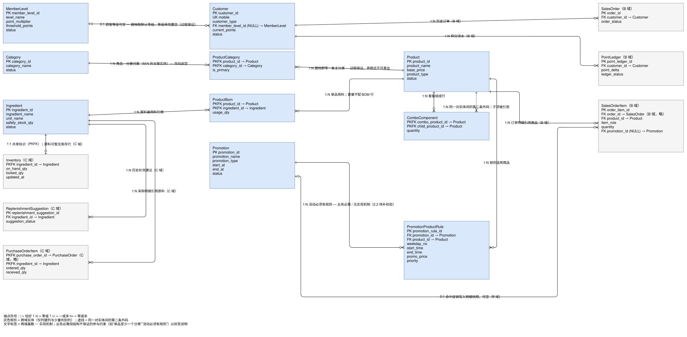

图里 16 个实体，属于 A 域的是 10 张：分类、商品、商品分类、原料、商品配方、套餐组成、会员等级、顾客、促销活动、促销规则。另外 6 张是 B 和 C 的表——订单、订单明细、积分流水、库存、补货建议、采购明细——画进来是因为它们引用商品、顾客和原料：商品换价、等级停用会顺着这些引用影响下单和库存。

商品和分类是多对多，用 `ProductCategory` 拆开，`is_primary` 标主分类。配方和套餐组成都是“父商品带子项”，配方记用量`usage_qty`，套餐记份数 `quantity`，同一个父商品下同一个子项只允许出现一次，由唯一键保证。

会员等级与顾客是“一位顾客最多一个等级”，`Customer.member_level_id` 允许为空。等级停用后这一列被置空，但顾客已有的积分不重算——`current_points` 是期初 offset 加流水累计，等级只影响之后的积分倍率。

### 2.2 页面设计

店长登录后从身份页进入主数据工作台。工作台按实体分成九个页面：分类、商品、原料、会员等级、顾客、商品配方、套餐组成、促销活动、促销规则；另有一个总览页，把九个实体码列成卡片，和契约的实体码一一对应。

每个实体页骨架相同：上面是按状态筛选的列表，下面一到三个动作表单。商品页有新建、改价、改状态三张；会员等级页有新建、整行修改、停用启用三张；配方和套餐页只接受整体替换，每行写子项和数量，留空即为清空。

页面不读基表。列表一律走 `sp_list_master_records`，写入一律走第一阶段的写过程。页面只负责把表单值交出去，唯一键冲突、状态机、等级重复这些判断全部由库里的过程裁决，报错再按错误码翻译成一句话显示。

## 3. 实验过程

### 3.1 保存旧数据，写 A 域基线

先写 [baseline_a.sql](../../../sql/stage2/baseline_a.sql)，把 A 域的 10 张表、47 列按迁移批次采集下来。快照保留原主键值和空值，去掉 IDENTITY 和业务约束，只加批次号，方便区分是哪一次迁移前的数据。这份脚本不自己开事务、不切连接，由采集入口在外层事务里执行，三个域的快照落在同一批次里。

### 3.2 在迁移脚本里补候选码和过程

[11a 迁移脚本](../../../sql/stage2/11a_master_migration.sql) 分三段。第一段是前置校验：库必须是 v0.1 的形状，五组唯一键涉及的列不能已有重复值；有重复值时错误信息把重复的业务键直接列出来，不用对着约束名猜是哪一行。第二段补五个唯一约束：会员等级的门槛分和等级名、分类名、商品名、原料的名称加单位——这些列在设计评审时定为候选码，v0.1 只建了索引没建约束。第三段复核终态，确认五个约束都以 `UNIQUE` 建出来了，缺任何一个整笔迁移回滚。

过程新增五个。`sp_list_master_records` 按实体码取数，支持状态过滤，一次最多 200 行；`sp_list_sale_products` 给收银页取在售商品和当前生效价；`sp_find_customer_for_order` 和 `sp_register_customer_for_order` 给收银页查客和建档。

最后是顾客自助建档 `sp_customer_register`。手机号必须是 11 位数字；已建档的号码直接回读原记录并返回“不是新建”，不覆盖类型、等级和积分；查重时加 `UPDLOCK, HOLDLOCK`，把同一号码的并发建档挡在门外；默认等级不存在时沿用 `51001`。这个过程不读 `USER_NAME()`，执行权限只授给 C 建的顾客账户 `cust_app`。

### 3.3 把主数据接到应用层

访问层 [app/common/](../../../app/common/) 是五个模块：配置、连接、错误映射、日志、事务。`db.py` 是唯一开连接的地方，参数必须用 `SqlParam` 显式定型——时间要挑 `SQL_SS_TIME2`，长 JSON 要用 `NVARCHAR(MAX)`，否则会被截断或转换失败。

主数据域按三层写：[dao.py](../../../app/master/dao.py) 有 23 个过程包装，[service.py](../../../app/master/service.py) 有 23 个业务函数和 10 个校验小工具，[routes.py](../../../app/master/routes.py) 用实体表和动作表两张配置驱动九个实体的列表和 18 个动作，模板 13 份（4 个页面加 9 张表单）。

### 3.4 编写店长维护页

页面顶部是同一条导航，总览、分类、商品、原料、会员等级、顾客、商品配方、套餐组成、促销活动、促销规则十个入口，当前页高亮。列表页的列由实体表配置生成，和契约的列顺序一致，模板不再裁剪。

列表允许看到停用项，因为店长维护时经常要先停用再改；但写入按钮只提交表单，成不成功由数据库说了算。报错显示在表单上方一行，按错误码翻译；成功则回到列表并在顶部提示。

身份每个请求都重新取：从会话里拿该员工自己的数据库登录去连库，页面不缓存“我是店长”这种结论。这样账号被停用后，下次操作就会失败，而不是继续拿旧身份干活。

### 3.5 联调和检查

应用层测试不连库，把连接换成假对象，逐个动作核对提交的参数顺序和错误码翻译，共 36 条。

库内实测用临时创建的店长 SQL 登录加一次性的员工账号，在回滚事务里执行真实过程，验完立即删除账号、撤掉临时授权，不为了好测在代码里留跳过守卫的开关。四个接口跑了 14 条断言，含两个越权方向：没有授权时拿不到执行权限（229），岗位对不上时被过程拒绝（51004）。

最后在本机把整条迁移链跑了一遍：先备份，再采集基线，然后执行迁移脚本提交 v1.0，最后跑回归。结果如下。

| 检查 | 结果 |
| --- | --- |
| A 域模型 | 10 表 / 47 列 / 10 主键（含 3 个复合主键） |
| 五个候选码 | 全部以 `UNIQUE` 建出，前置与终态校验逐条走通 |
| A 域回归 `13a` | **10 条断言全过**（真实迁移后随总回归执行） |
| 主数据应用测试 | **36 通过 / 0 失败**（假连接，分母硬编码 36） |
| 共享访问层测试 | **18 通过 / 0 失败** |
| 本机整链迁移 | 提交 v1.0：15 个过程 / 58 个权限码 / 71 行角色授权 |
| 总回归 `regression` | **38 通过 / 0 失败** |
| 迁移前后逐行对照 | **PASS，0 差异行**（订单 / 明细 / 库存 / 顾客四组，见 `result/stage2/a-migration-compare/`） |

迁移有没有改坏数据，单独用一份只读脚本回答：把 `MigrationBaseline_*` 快照（`batch_id = 1`）与迁移后的业务表逐行比一遍——三张订单、三条明细的金额与状态前后相同（总额都是 47.90），6 行库存的在库总量与锁定量为 34338.00 / 0.00，3 位顾客的积分合计 2028 都没有变。权限侧是"只增不减"：基线里 46 个权限码迁移后一个不少，同名权限码的名称没有一处被改，新增 12 个（`sp_list_master_records`、`sp_register_customer_for_order` 等），授权行从 52 扩到 71。脚本与原始输出见 [result/stage2/a-migration-compare/](../../../result/stage2/a-migration-compare/)。

## 4. 实验结果

以下截图全部来自本机迁移完成的 v1.0 库，用店长账号登录后逐页渲染，页面里的数据就是库里的真实行。

### 4.1 员工登录

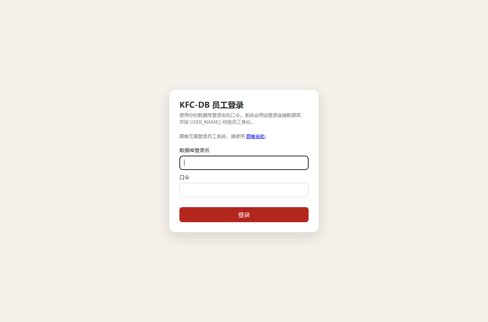

输入数据库登录名和口令，登录后按 `USER_NAME()` 认出员工身份。右侧另有“顾客自助”入口给顾客用。

### 4.2 我的身份

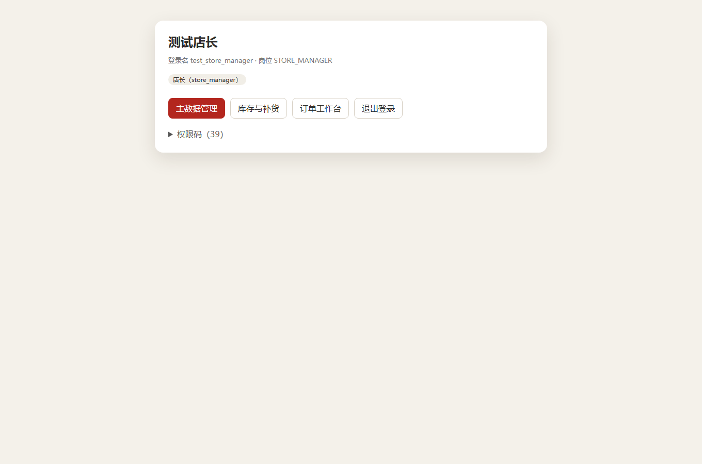

登录名 `test_store_manager`，岗位 `STORE_MANAGER`，对应库角色 `store_manager`（店长）。展开“权限码（39）”，可以看到这个角色能调的 29 个过程和 10 个视图，下面的四个入口是主数据管理、库存与补货、订单工作台和退出登录。这份清单来自库里的角色授权。

### 4.3 主数据总览

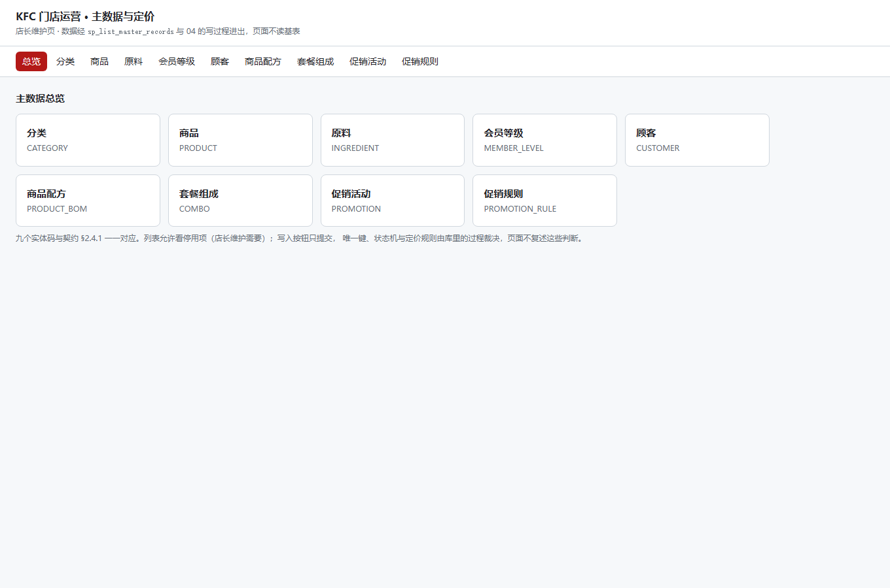

九个实体码排成卡片，与契约的实体码一一对应。总览页只做索引入口，不放任何写操作。

### 4.4 分类

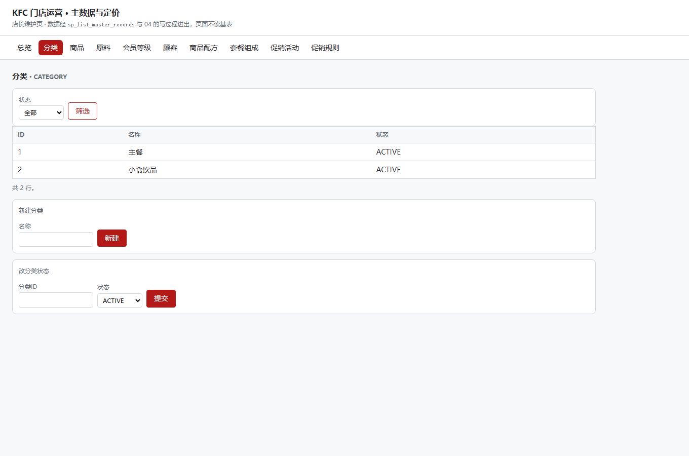

库里两条分类：主餐、小食饮品，都是启用状态。上方可按状态筛选，下面两张表单分别是新建分类和改分类状态。

### 4.5 商品

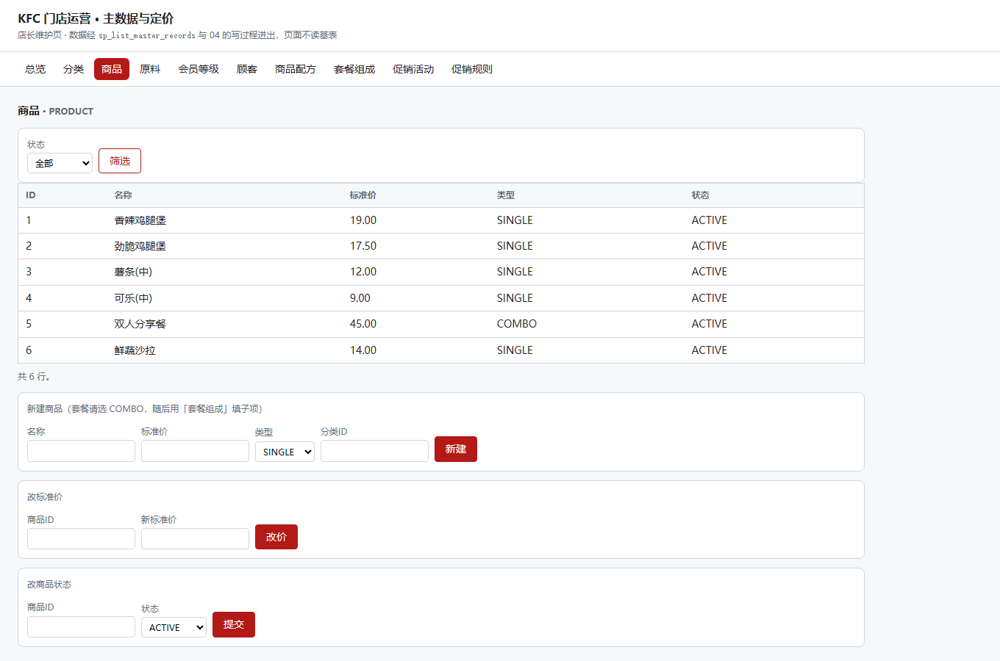

六件商品。香辣鸡腿堡 19.00 元、劲脆鸡腿堡 17.50 元、薯条（中）12.00 元、可乐（中）9.00 元、鲜蔬沙拉 14.00 元都是单品；双人分享餐 45.00 元类型是 `COMBO`，它的子项在“套餐组成”页维护。三张表单分别是新建、改标准价和改状态，类型和分类在新建时一次定好。

### 4.6 原料

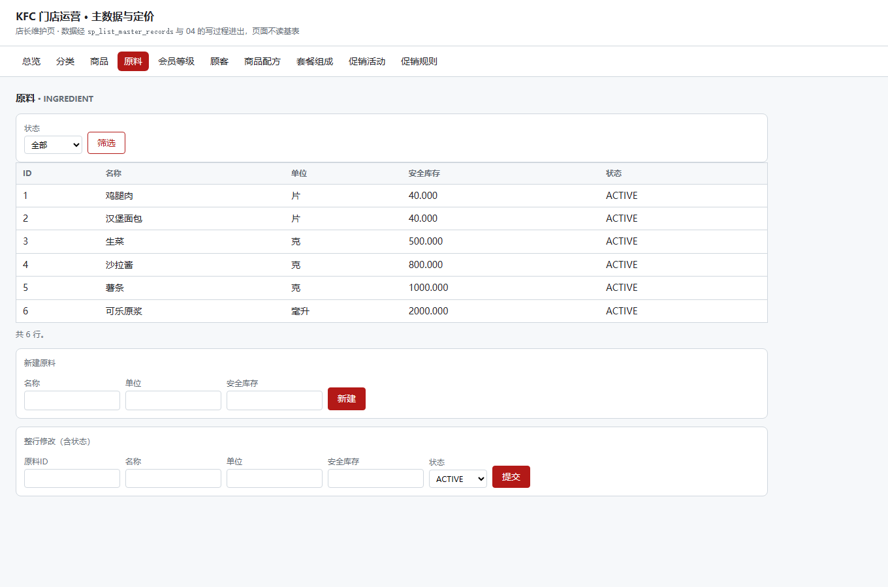

六种原料，带单位和安全库存：鸡腿肉、汉堡面包各 40 片，生菜 500 克，沙拉酱 800 克，薯条 1000 克，可乐原浆 2000 毫升。安全库存是 C 的补货建议用的门槛，这里只维护数值。下面的表单整行修改，包括状态。

### 4.7 会员等级

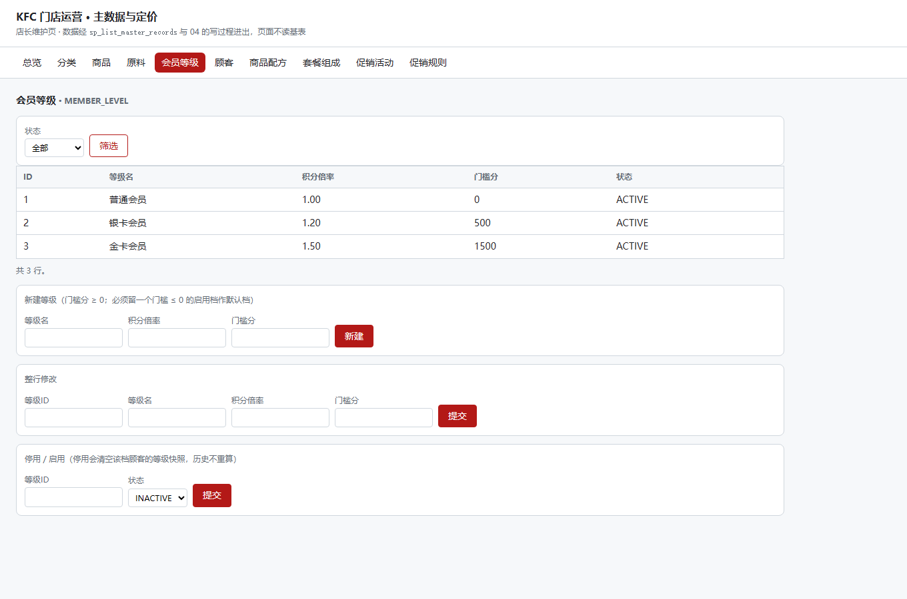

三档：普通会员 1.00 倍、门槛 0 分；银卡 1.20 倍、500 分；金卡 1.50 倍、1500 分。门槛分必须唯一，而且至少要留一档门槛不高于 0 的启用等级作默认档，否则新建顾客时取不到默认等级。停用某一档会清空该档顾客的等级快照，历史积分不重算。

### 4.8 顾客

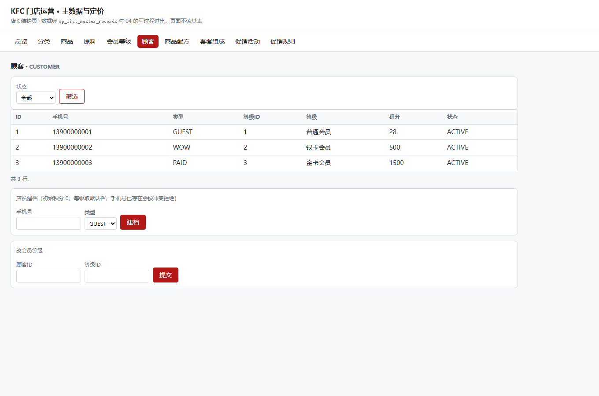

三条顾客记录：访客、`WOW` 会员、付费会员，等级分别是普通、银卡、金卡，积分 28 / 500 / 1500，都在启用状态。店长建档时初始积分固定为 0、等级取默认档；手机号已存在会按冲突拒绝，不会静默覆盖。

### 4.9 商品配方

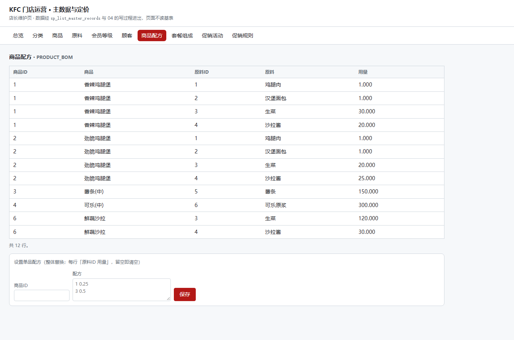

共 12 行。香辣鸡腿堡用鸡腿肉、汉堡面包各 1 份，生菜 30 克，沙拉酱 20 克；劲脆鸡腿堡是生菜 20 克、沙拉酱 25 克；薯条（中）只有薯条 150 克；鲜蔬沙拉是生菜 120 克加沙拉酱 30 克。配方整体替换，保存时按行提交，格式不对整批拒绝，不会留下写了一半的配方。

### 4.10 套餐组成

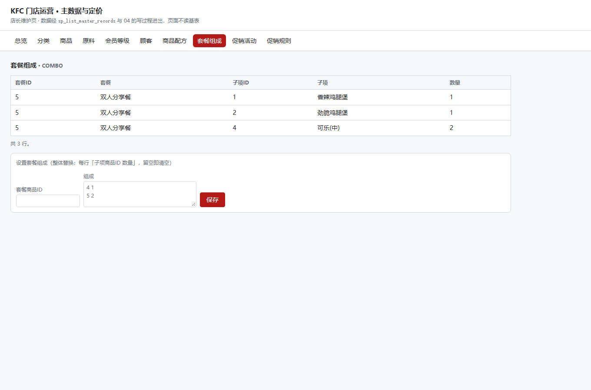

只有双人分享餐一个套餐，三个子项：香辣鸡腿堡 1 份、劲脆鸡腿堡 1 份、可乐（中）2 份。收银算钱只算套餐本身的价格，配餐时则要展开到这些子项。

### 4.11 促销活动

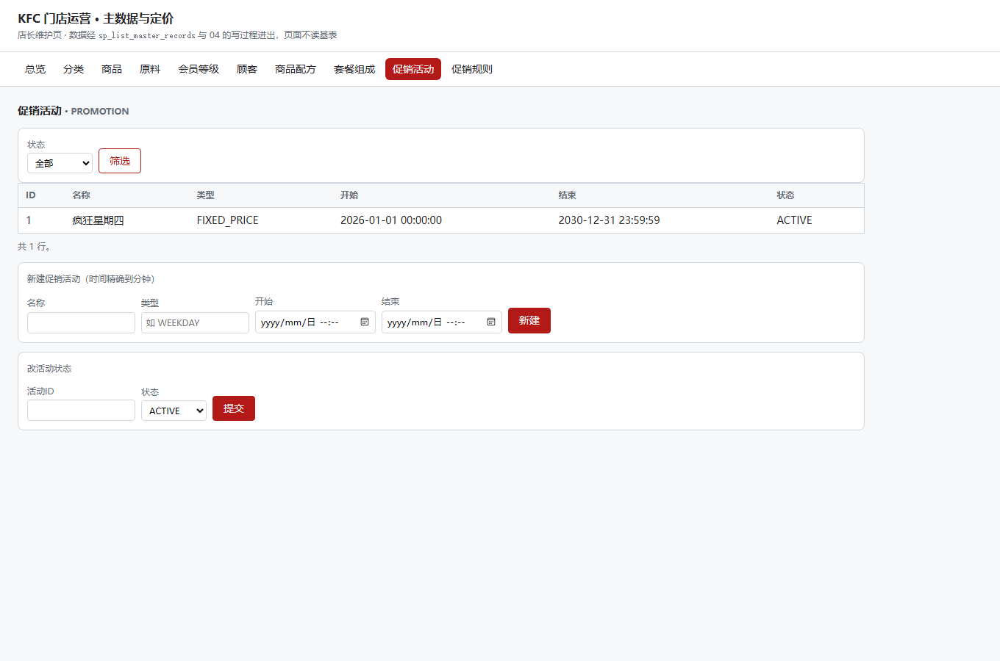

一个活动“疯狂星期四”，类型固定价，有效期从 2026-01-01 到 2030-12-31。活动本身只定时间和状态，具体哪个商品哪一天卖多少钱，在“促销规则”页配置。

### 4.12 促销规则

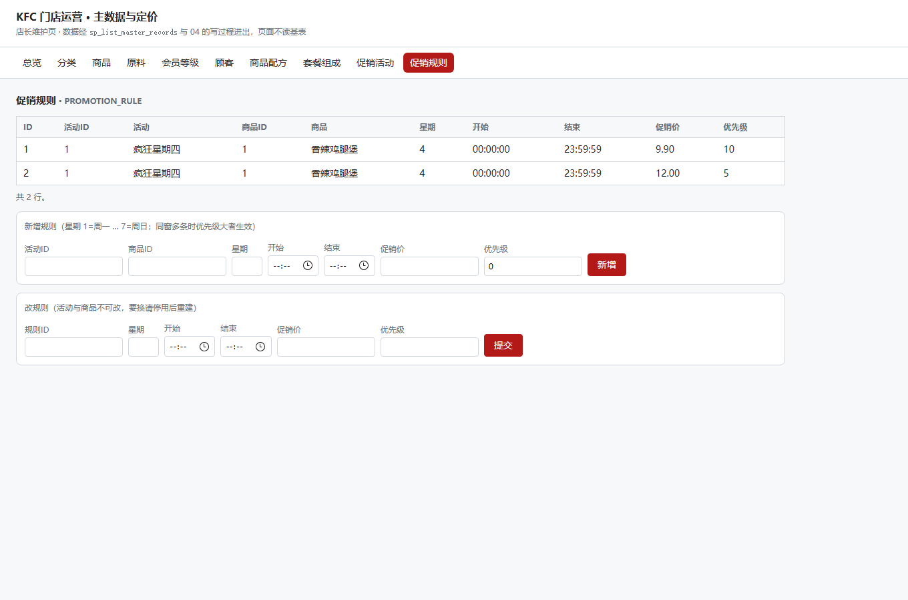

香辣鸡腿堡在星期三有两条规则：促销价 9.90 元优先级 10，12.00 元优先级 5。同一个时间窗允许配多档，取价时按优先级从大到小选第一条，所以实际生效的是 9.90 元。这条规则在 A 域回归里也有对应断言：同窗两档价必须取高优先级那一档。

## 5. 遇到的问题及解决方法

### 5.1 过程返回多个结果集时，出错被当成了成功

共享访问层最初只取第一个非空结果集，读下一个结果集时如果抛错，就把已经读到的行当作成功返回了。支付详情、配餐明细这类过程都是分两段返回的，一旦第二段出错，页面会显示一份缺了明细的订单，看起来却像正常。

改法是按顺序读完所有结果集，空集也占位，读下一集的异常一律抛出去走错误映射。改完补了测试：两个结果集和三段（中间空集）都要按序返回，先 `SELECT` 再 `THROW` 的过程要报错而不是返回行。

### 5.2 连接池把两个人的身份混在一起

验收时发现一个隐患：ODBC 驱动默认会复用连接，而所有过程都用 `USER_NAME()` 。连接一旦被复用，库里看到的还是上一个员工的登录名，日志里却是新员工，一旦出错几乎无法排查。

处理办法是在唯一开连接的地方每次先关掉驱动池。pyodbc 只有模块级的开关，没有单连接参数，所以只能设在入口；这样任何路径进来的连接都先过这一道。对应的测试是三个账号交替连接，必须拿到三条不同的连接，每次的 `user` 也要对得上。

### 5.3 配方里的小数进不了 JSON

建配方和套餐的表单按“每行子项加数量”提交，服务层先拼成 JSON 再交给过程。第一次测发现只要配方里有 `0.500` 这种小数，拼 JSON 就抛类型错误，任何一次合法的配方保存都会崩在服务层。

原因是 `Decimal` 不能被直接序列化。改成按字符串绑定后，过程那边的转换照常工作，`0.500` 的末位也没有丢。改完用真实过程在回滚事务里验证了一遍保存和读回。

### 5.4 手机号被悄悄截短

建档过程的手机号参数是 `VARCHAR(20)`，超长入参在绑定时会被无声截成 20 位。当时讨论过要不要收姓名，最后删掉了这个参数——顾客表没有姓名列，数据边界也没有把姓名收进来，留着只会造成误会。

手机号则必须校验：21 位的号码一旦被截成 20 位，可能给另一个人建档。现在先判 11 位数字再落库，位数不对直接按输入错误拒绝。

