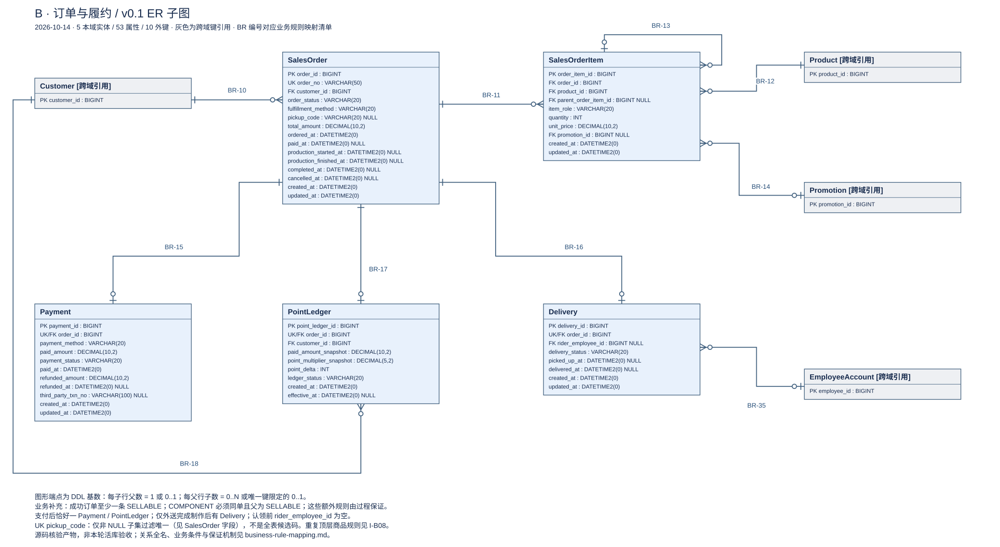
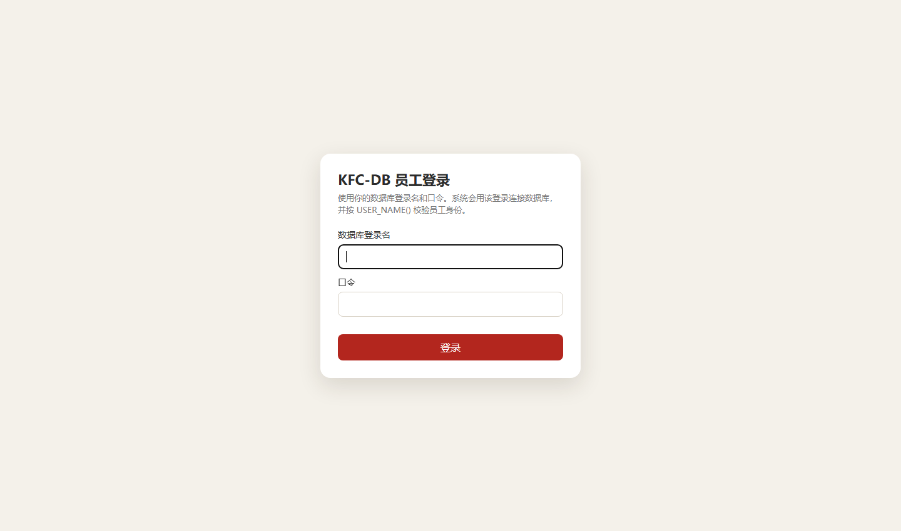
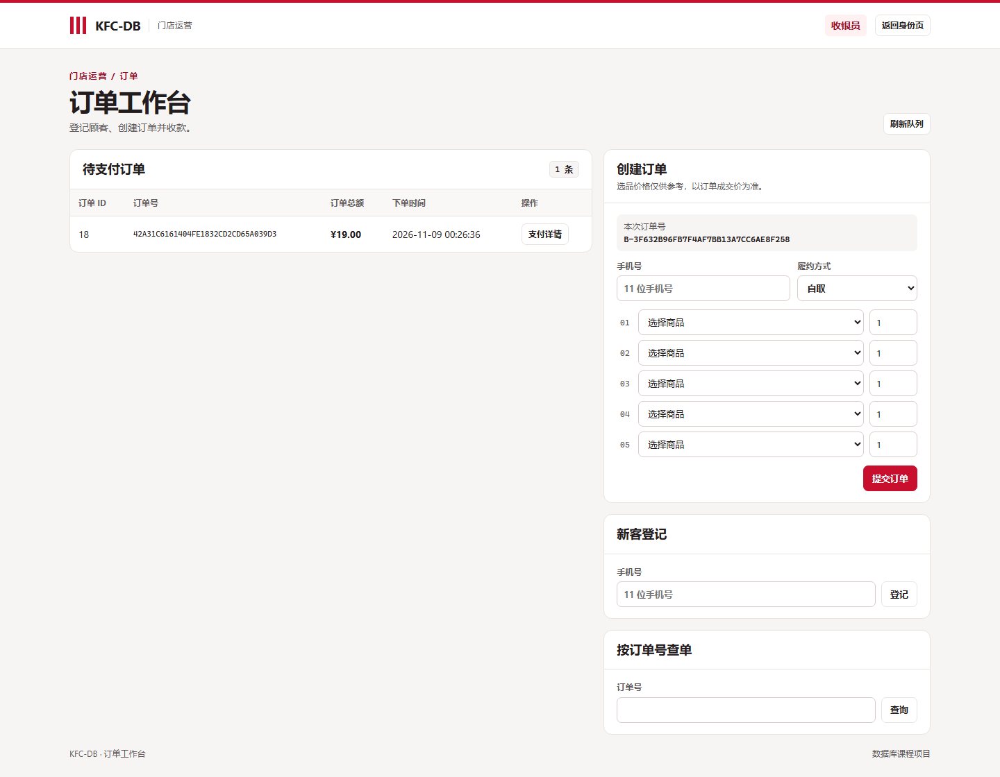
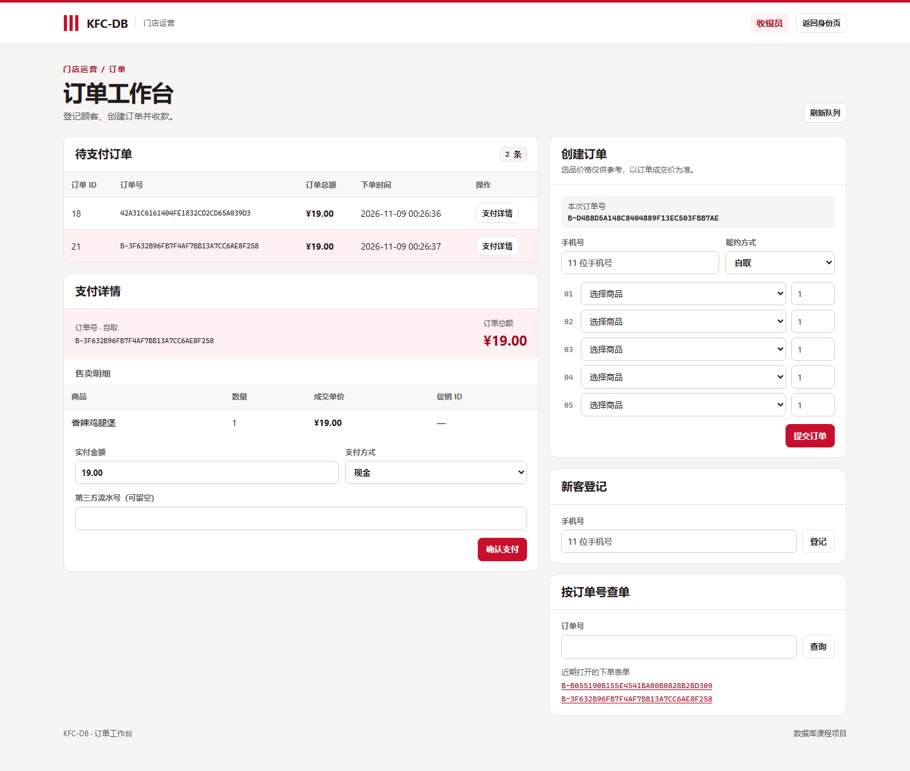
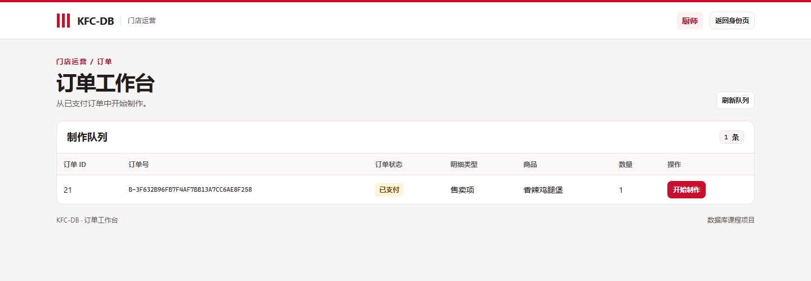
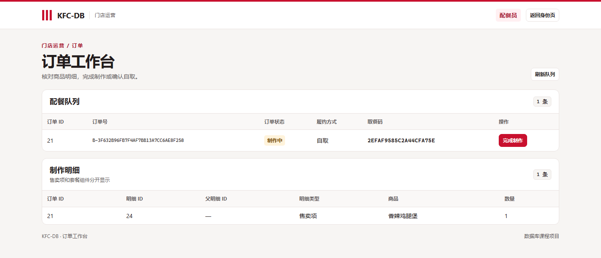
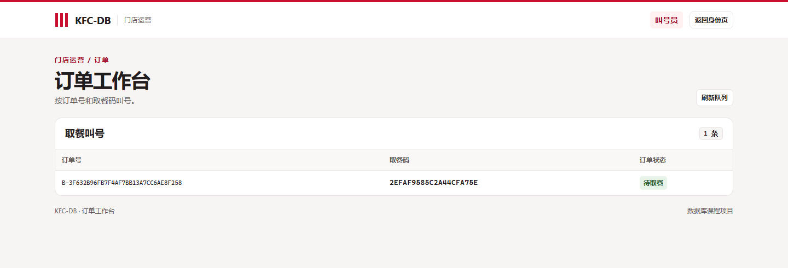
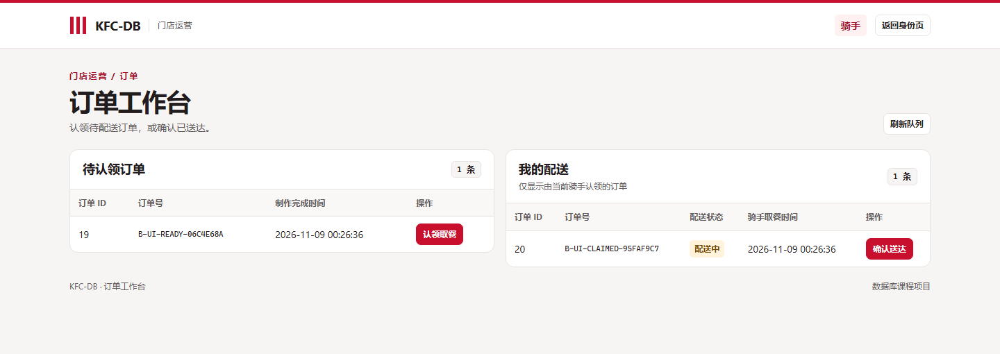
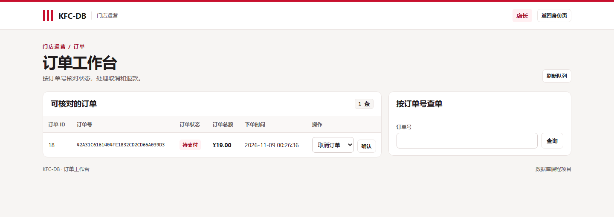

# 成员 B 的 Stage 2 阶段报告：订单、支付与履约

> 日期：2026-11-08；角色：B（订单、支付、履约与积分）。
> 姓名：张奕希；学号：24325328。

## 1. 实验思路

第一阶段已经用存储过程实现了下单、支付、制作和履约。这一阶段把这些操作接到岗位页面上。比如收银员付款后，厨师应该看到待制作的订单；制作完成后，同一笔自取单又应该出现在叫号页上。实验时我用同一个订单 ID 对照各个页面，观察它的状态怎么变。

## 2. 实验设计

### 2.1 订单域 ER 图

图中间是订单（`SalesOrder`）。一位顾客可以下多笔订单，每笔订单只属于一位顾客。订单和订单明细是一对多关系：明细用 `order_id` 指回订单，用 `product_id` 指向商品。外键能防止明细挂到不存在的订单上，但不能保证每笔订单至少有一条明细，所以空购物车是在下单过程里拒绝的。

订单明细还有一条指向自己的线。普通单品和套餐父项的父明细为空，套餐组件才用 `parent_order_item_id` 指向父项。收银算钱时只算售卖项，配餐时还要看到组件。明细里的单价和促销记录是下单时保存的，后来商品调价也不会改到旧单。

支付、配送和积分流水都通过 `order_id` 连回订单，而且这三张表各自的 `order_id` 都不允许重复。这里的关系是“一笔订单对应零条或一条”，不是下单时三条记录就同时存在：刚下单还没有支付，自取单没有配送记录；外送单完成制作后会生成配送记录，没人认领时骑手字段为空。积分流水和支付分开存，付款后先记为待生效，取餐或送达后才生效；未履约而退款时，原付款记录仍在，待生效的积分作废。

### 2.2 岗位页面

工作台入口是 `/orders/`。收银员查待支付订单，厨师看制作队列，配餐员看订单和商品明细，叫号员只看待取餐信息。骑手的页面分成待认领和我的配送两个列表，店长按订单号核对状态和处理取消、退款。页面上的按钮按岗位显示。

## 3. 实验过程

### 3.1 保存旧数据，编写迁移脚本

先写 [baseline_b.sql](../../../sql/stage2/baseline_b.sql)，把订单、订单明细、支付、配送和积分流水这五张表按批次保存下来。快照表里保留原来的主键值、成交价、时间和空值，另外加上批次号，方便区分是哪一次迁移前的数据。迁移完成后，回归脚本从 v1.0 的版本记录找到对应批次，先核对结构和行数，再双向比较字段值。另写了一份检查，核对原有八个写过程的参数名称、顺序和类型。

### 3.2 在数据库里补员工查询和顾客下单

[11b 迁移脚本](../../../sql/stage2/11b_order_migration.sql)补了六个员工查询：待支付列表、支付详情、订单状态、配餐队列、我的配送和待认领配送。支付详情分两份返回，第一份是订单和总额，第二份是实际售卖的商品；配餐也分两份，但第二份还要包括套餐组件。写配餐查询时，先选出本次要显示的订单，再找这些订单的全部明细。

11b 不只写了查询，还新写了顾客自取下单。先检查手机号对应的顾客是否可用，再检查商品和份数。订单号和取餐码由数据库生成，价格调用 A 的定价函数，写入订单和明细后调用 C 的锁库过程。这几步在同一个事务里，库存不够就一起回滚，不留下有订单却没锁到库存的记录。顾客查单则同时核对手机号和取餐码，只返回匹配的订单头。

### 3.3 把下单、支付和履约接到应用层

员工端没有重写第一阶段的八个写过程，而是在 [service.py](../../../app/orders/service.py) 和 [dao.py](../../../app/orders/dao.py) 里把它们接起来。服务层先检查表单传来的值，例如订单 ID 和份数必须是正整数，金额用十进制数，没填的第三方流水号传成 NULL。DAO 再通过 A 的共享连接层，把这些值作为参数传给 SQL Server。

八个写操作分别是下单、支付、开始制作、完成制作、确认自取、骑手认领、确认送达和取消或退款。比如页面点“确认支付”，路由取出订单 ID、实付金额和支付方式，服务层检查后交给 DAO，再调用已有的 `sp_pay_order`。是否已经付过、金额能不能对上，仍由存储过程判断。退款也一样，页面提交退款原因，实际释放库存和作废未生效积分由数据库处理。

### 3.4 编写岗位页面

在 [routes.py](../../../app/orders/routes.py) 里加了打开工作台和提交操作的路由。打开页面前先查当前员工身份，再按岗位取数据。收银页把待支付列表和下单表单放在两边；厨师和配餐员可以在对应订单行上开始或完成制作；叫号员只看取餐信息；骑手分别看还没人接的单和自己已经接的单；店长可以查状态和提交取消或退款。

### 3.5 联调和检查失败情况

用临时库从第一阶段开始跑，按 `11a → 11b → 11c → 12` 的顺序迁移，再执行回归检查。之后用不同岗位账号走同一笔自取单，从下单、付款一直做到确认自取。外送用另外的测试单核对认领和送达，退款另用已付款的订单核对。还把临时库的可用库存压到零再下单，比较失败前后的订单、明细和库存流水，看有没有只写进去一半。

## 4. 实验结果

### 4.1 员工登录

从登录页分别输入测试账号和口令，登录后进入对应岗位的工作台。

### 4.2 收银下单

收银页左边是待支付队列，右边可以下单、登记新客和查单。填入手机号，选自取，再选商品和份数。还没点“提交订单”时，表单就已经显示本次订单号。如果提交后没收到响应，可以先拿这个号去查，不用换号重下。

### 4.3 查看支付详情

下单后，订单 21 出现在待支付列表。点开这笔单的支付详情，可以看到买的是 **1 份香辣鸡腿堡**，成交单价和订单总额都是 **19.00 元**，下方的实付框也带出了 19.00 元。这次选现金支付，然后第三方流水号留空。

### 4.4 厨师开始制作

付款后退出收银账号，换厨师账号登录。图 4 里还是订单 21，状态显示“已支付”。这时可以点同一行的“开始制作”。

### 4.5 配餐员完成制作

厨师开始制作后，换配餐员打开工作台，订单 21 的状态已经变成“制作中”。上面一张表是订单，下面一张表是商品明细。这次买的是单品，所以明细只有一行。核对商品后点“完成制作”。

### 4.6 自取叫号

制作完成后，订单 21 出现在叫号页，状态显示“待取餐”。图 6 的取餐码与图 5 相同。这个页面只列订单号、取餐码和状态。顾客取餐后，由配餐员确认自取。

### 4.7 骑手查看配送订单

图 7 是另外两笔单。订单 19 做好后还没人认领，列在左边，旁边有“认领取餐”；订单 20 已经由当前骑手取餐，列在右边的“我的配送”，状态是“配送中”，对应的按钮是“确认送达”。

### 4.8 店长查看和取消订单

店长页右边可以按订单号查状态。左边的订单 18 还没付款，所以同一行给出的是取消入口。已付款订单的退款用另一笔测试单在数据库里验证，图 8 没有演示退款。

## 5. 遇到的问题及解决方法

### 5.1 支付已写入，页面却报错

第一次测图 3 这种现金支付时，我把流水号留空，页面却报了错。我开始以为支付没有写进去，但查订单已经是已支付，支付表里也有记录。后来发现是数据库先提交，驱动再读结果时出错。这时不能因为页面报错就再付一次。

处理办法是遇到这个特定错误后先查订单，确认支付成功而且实付金额一致，再提示已经付款，不重新提交支付。复测时支付表里仍只有一条记录，流水号也还是 `NULL`。

### 5.2 员工停用后，原来打开的页面怎么办

最开始工作台用的是登录时记下来的岗位。复查时发现，叫号员登录后如果被停用，旧会话里还留着“叫号员”这个身份，只检查有没有登录是不够的。

我把身份检查加到了打开工作台和提交操作之前，每次都用当前账号向数据库确认。复测时，我先用叫号员账号打开图 6 的页面，再在临时库里停用这个账号。不退出，直接刷新，页面就跳回了登录页，也没有再返回待取餐订单。
