# 第二阶段阶段报告：KFC 门店运营数据库（v1.0）

本报告是第二阶段的总报告，覆盖 2.1 ER 模型重建、2.2 规范化与数据库迁移、2.3 应用开发三段工作。成员 A（24325106 胡志远）、B（24325328 张奕希）、C（24325108 黄柏源）各自的实现细节见[成员 A 阶段报告](a-stage2-report.md)、[成员 B 阶段报告](b-stage2-report.md)、[成员 C 阶段报告](c-stage2-report.md)，测试数字与环境见[第二阶段测试报告](../test-report.md)。

对应代码分为三块：`docs/er/` 下三张域子图与一张合并总图；`sql/stage2/` 下基线采集、`11a/11b/11c`、`12`、`13a/13b/13c` 与 `run_migration.sql` / `regression.sql`；`app/` 下 `common` 访问层与 `auth` / `master` / `api` / `orders` / `inventory` / `customer` 六个蓝图，启动入口是 `run.py`。

## 1. 设计思路

### 1.1 第二阶段要解决的三件事

第一阶段交付的是 v0.1：25 张业务表、42 个存储过程、7 个岗位角色，可以从空库一次部署。但它留下三类问题，正好对应第二阶段的三个任务。

第一，ER 图与表结构没有完整对照。第一阶段只有文字与字典，联系两端到底是"结构上的 0..N"还是"业务上必须至少一条"，没有一张图统一说明。2.1 因此重画三张域子图与一张合并总图，所有 25 个实体、35 条物理外键全部要有落点，并把"图怎么画"写成图例，避免三个人各画一套。

第二，部分关系存在更新异常。`RolePermission` 把权限码和权限名称放在同一行，名称只依赖权限码、不依赖角色，属于对复合码的部分依赖；另有一批业务唯一事实只靠过程保证、约束层没有声明。2.2 因此做三域范式分析，只改有论证的项：A 补五条候选码，B 保留五表并说明为什么不拆，C 拆出 `Permission` 并补一条采购单候选码；论证不成立的拆分一律不做。

第三，第一阶段的库没有"怎么安全升级"的答案。直接改表结构会丢历史账，删库重建又会把验收数据冲掉。2.2 因此把迁移做成"先采集基线、再单事务升级、最后逐值回归"的链，版本标记只由迁移脚本写入，失败整体回滚。

2.3 则把这套库接到岗位上：店长维护主数据，收银、厨师、配餐、服务员、骑手、值班经理各看自己那一屏，顾客不登录员工系统也能建档、下自取单、用手机号加取餐码查单。

### 1.2 ER 重建：三张子图与一张总图

三张子图按域切分，但都保留了被外域引用或引用外域的表，所以同一张表可能在两张子图里以不同身份出现：在属主域里是实体，在引用方是灰色参照框。这样"某条外键从哪来、到哪去"在单张图上就能看全，不必来回翻三张图。

- [主数据域子图](../../er/a-master.svg)：16 个实体，其中 A 属主 10 张，另 6 张是订单、明细、积分流水、库存、补货建议、采购明细。后 6 张画进来是因为它们引用商品、顾客、原料，商品换价、等级停用会顺着这些引用影响下单和库存。
- [订单域子图](../../er/b-order.svg)：订单、明细、支付、配送、积分流水五张核心表。订单与明细是一对多，明细用 `parent_order_item_id` 自引用表达套餐父子；支付、配送、积分流水各自用 `order_id` 唯一约束收窄成"一笔订单至多一条"。
- [库存权限域子图](../../er/c-inventory-security.svg)：12 个实体、14 条联系，覆盖库存、流水、补货、采购、员工、角色、权限与审计；`Ingredient` 作为 A 域表以灰框出现，`AuditLog` 补入后不再有无落点的表。
- [合并总图](../../er/stage2-model.svg)：25 个实体、35 条物理外键（A 9 / B 10 / C 16），每条联系带 `BR-01`–`BR-35` 业务规则编号，可以直接对回[业务规则映射](../business-rule-mapping.md)。

画法上有一条全组统一的口径，来自 OI-09 的争议：**乌鸦脚只画 DDL 的结构基数，业务上"必须至少一条"之类的约束写进标签**。理由是外键只证明子项可以引用父项，并不保证父项一定有子项；把业务最低数画成 `1`，会让图与库对不上。图例（[legend.md](../../er/legend.md)）按这个口径改过，C 的子图 r6 也从 `ERoneToMany` 改成 `ERzeroToMany`。

总图不是手工拼出来的：C 的脚本按 schema 生成实体、列与外键，再核对三张子图，结构判据与几何判据共 **103 项、0 失败**（证据 `result/stage2/stage2-model-check-2026-10-27.txt`）。命名侧由 A 逐名核对：35 条外键**全部具名、无重复、无遗漏**，A 域 `01` 里"`constraint FK_x` 与 `foreign key(...)` 分两行写"曾被误判成匿名，按跨行匹配重扫后订正为 35/35（OI-12）。

### 1.3 规范化：只改有论证的项

三域各写一份分析，结论按"改什么、为什么改、不改什么、为什么"落表，最后汇总进[重构方案](../refactoring-design.md) §7。

**A 域**（10 表 / 47 列）补五条候选码声明：`MemberLevel.threshold_points`、`MemberLevel.level_name`、`Category.category_name`、`Product.product_name`、`Ingredient(ingredient_name, unit_name)`。前四条是"业务上不允许重名/同门槛"，第五条是因为单位是原料身份的一部分，同名不同单位仍合法。另有三条冻结语义：`Customer.current_points` 定性为"期初 offset + 流水物化增量"、`member_level_id` 是当前快照且等级停用置空、同一时间窗允许多档促销并按优先级取一条。A 域**不拆表**：分类与商品是多对多，`ProductCategory` 已经是正确分解；把分类并进商品会造出真的传递依赖。

**B 域**（5 表）结论是保留：订单明细的价格、促销、角色、父项都是历史快照，支付、配送、积分用唯一约束表达"至多一条"。`PointLedger` 的 `(实付, 倍率) → 积分` 在理论上可以拆成两张表，但拆出来的"金额/倍率组合"没有独立业务对象，还要另建公式字典；B 选择保留积分作为事件值，公开这一处 3NF 取舍，并在写入与回归时核对公式。

**C 域**（10 表）做两处结构变更。一是拆 `RolePermission`：原表 `(business_role_id, permission_code, permission_name, status)` 中，名称只依赖权限码，是对复合码的部分依赖，违反 2NF；拆成 `Permission(permission_code PK, permission_name)` 与 `RolePermission(business_role_id, permission_code, status)`，公共属性是 `permission_code`，且 `permission_code → permission_name` 落在新表，二元分解无损且保持依赖。权限白名单的固定枚举 `CHECK` 随码迁到 `Permission.permission_code`，不改成"目录行即白名单"的纯外键方案——目录管名称、外键管引用、`CHECK` 管"哪些对象可被授权"，三者职责不同。二是给 `PurchaseOrder.replenishment_suggestion_id` 补唯一约束，把"一张建议单最多一张采购单"从过程保证升级为约束保证。

不做的项也都留了理由：不物化可售量（视图计算，避免两处同步）、不给多态引用建三列外码、不把 `job_code` 与业务角色合并、不给促销名/时间窗补唯一（同名跨期、同窗多档是设计内合法数据）。传递依赖的教学示例只写在文档里，**不创建 `DEMO_*` 表**。

### 1.4 迁移设计：基线、单事务、门禁

迁移链的顺序是固定的：

```
停写并备份 → capture_baseline.sql → run_migration.sql → regression.sql
```

**基线先行。** `capture_baseline.sql` 要求操作者显式传入 `SourceBaseline` 与 `ConfirmAppStopped=YES`，并把确认写进 `MigrationBatch`；数据库无法证明外部应用已经停写，所以这一步不伪装成自动检测。每次采集是一个新批次（`batch_id` 自增、永不复用），在一个 sqlcmd 会话、一个事务里把 25 张业务表全量复制到 `Baseline_<Table>`，同时登记表级行数、`content_checksum` 与库级 `schema_digest`。批次状态机是 `CAPTURING → COMPLETED`，失败走 `FAILED`，只有 `FAILED → VOID` 一条作废边，`COMPLETED` 不可覆盖。采集与迁移入口都先取 `KFC_DB.Stage2Migration` 的应用锁，拿不到就失败。

**单事务升级。** `run_migration.sql` 先重算 `schema_digest` 与行数，发现漂移就停；然后在**一个外层事务**里按 `11a → 11b → 11c → 12` 执行，再做事务内只读检查（`53510`–`53516`），全部通过才写 `SchemaVersion('v1.0')` 并 `COMMIT`。任何一步失败都回滚整个外层事务，库仍是 v0.1，不留下"迁移了一半"的现场；域脚本不允许自己提交外层事务。`13a/13b/13c` 在提交之后跑，从 `SchemaVersion('v1.0')` 取批次号，只认同一个 `COMPLETED` 批次，不跨批拼数据。

**不删库、不重建。** 整条链没有 `DROP DATABASE`、没有 `DROP TABLE`、没有无条件 `DELETE`；迁移只做加表、加列、加约束、加过程和授权，原表数据原地保留。回滚的语义是"事务回滚到 v0.1"，不是"删掉重来"。

**逐值对账。** 摘要只用于定位，不用作相等证据。`13a/13b/13c` 按主码 `FULL OUTER JOIN` 双向比较，NULL 与 0 严格区分，金额精确到分；A 另写了一份只读的迁移前后对照脚本，把快照与 v1.0 业务表逐行比一遍（见 §2.3）。

### 1.5 应用层：薄页面、厚数据库

应用分四层，依赖方向只有一条：

```
routes.py（HTTP、模板/JSON） → service.py（输入边界与编排） → dao.py（过程名与参数定型） → app/common/（唯一连接与事务边界）
```

`app/common/` 是三个域共用的底座，冻结了五个签名：`open_connection`、`query`、`query_procedure`、`query_procedure_sets`、`execute_procedure`。所有 DAO 只按这五个签名调用，不 import pyodbc、不自己连库、不自己开事务、不新增错误码。几个关键口径：

- **每次请求用自己的员工身份连库。** 会话里存 `db_login` / `db_password`，`open_connection` 每次用这对凭据连接，并在连接前把 `pyodbc.pooling` 置 `False`，避免驱动池把上一个身份带进下一个请求。身份每个请求都重新向库确认，不缓存"我是店长"这种结论。
- **多结果集按序读完。** `query_procedure_sets` 返回全部结果集，空集占位，`nextset()` 的异常不再被当成"已读到的行就是成功"（OI-14）。
- **统一错误。** 数据库错误按九类映射成 `E_INPUT` / `E_FORBIDDEN` / `E_NOTFOUND` / `E_CONFLICT` / `E_RULE` / `E_TX` / `E_DB` / `E_UNKNOWN` 等，`body()` 固定返回 `{code, message, request_id}`；页面把错误渲染回同一页，接口层返回 JSON，日志里带 `request_id` 并可反查。
- **CSRF。** 页面表单带会话令牌，写接口要求 `X-CSRF-Token` 头；不匹配直接 `E_FORBIDDEN`，不碰数据库。

页面以服务端渲染为主：店长的主数据九实体、库存与补货、六个订单岗位屏、顾客自助都是"表单 POST → 整页返回"。商品页另外接了 `app/api/` 的 `/api/master`：`GET /api/master/<entity>` 取列表、`POST /api/master/<entity>/<action>` 提交动作、`GET /api/master/meta` 给出实体与动作元数据、`GET /api/csrf` 取令牌。接口不另写映射与校验，实体/动作表、`service`、存储过程与页面完全共用；配方与套餐子项的 JSON 数组在接口层转回页面那套"每行一条 id 数量"的文本，保证服务层只有一种入参。

### 1.6 权限与跨域契约

权限分两层。数据库层是 7 个业务角色加 7 个不带登录的测试用户，`GRANT` 精确到过程或视图；`Inventory` 表级 `DENY UPDATE`、`Customer.current_points` 与 `SalesOrderItem.unit_price` 列级 `DENY UPDATE`，堵住绕过过程直接改敏感字段。过程层每个写过程都按 `EmployeeAccount.database_user_name = USER_NAME()` 反查当前员工，确认启用且具备相应角色，解析不到抛 `51004`，不信任外部传入的主体参数。

v1.0 的权限面是 **58 个权限码、71 行角色授权**，另有 `cust_app` 对三个顾客过程的 3 条 `EXECUTE`。58 码里有 12 个是新增对象：B 的六个员工查询、C 的身份上下文与员工角色查询、A 的四个主数据查询/登记接口；`cust_app` 三个过程不进业务角色白名单，由 `12_permissions.sql` 单独 `GRANT` 并由 `13c` 以 `EXECUTE AS USER='cust_app'` 验证越权返回 `229`。

跨域只经冻结契约交互，不互相直写表：

- 第一阶段已冻结的 8 个写接口继续使用（下单、支付、开始/完成制作、确认自取、骑手认领、确认送达、取消退款），签名不变；
- 第二阶段补 6 个员工查询过程（待支付列表、支付详情、订单状态、配餐队列、我的配送、待认领配送）与 A 的 4 个查询/登记接口；
- 顾客端 3 个过程：建档、下单、查单。身份不是员工，过程只信 `(mobile, pickup_code)`，价格与库存仍由 A 的定价函数和 C 的锁库过程决定。

契约文本在[application-contract.md](../application-contract.md)（§2 写接口与查询接口冻结，§1 顾客端 §1.7 四条边界定稿），访问层签名在[access-layer-contract.md](../access-layer-contract.md)。

## 2. 实验过程

### 2.1 环境

三台机器都是 Windows + SQL Server 2025（17.0.1000.7），实例名不同：A 用 `localhost`，B 用 `localhost\MSSQLSERVER2`，C 用 `.\SQLEXPRESS`。客户端统一 `sqlcmd` + ODBC Driver 18，应用统一 Python 3.11 及以上、Flask 3.1.3、pyodbc 5.3.0（`requirements.txt` 写精确版本）。

`sqlcmd` 必须带 `-C -f 65001 -b`：`-C` 跳过自签证书校验，`-f 65001` 防止 UTF-8 脚本被按 936 代码页解码，`-b` 让任一 SQL 错误返回非零退出码。跑迁移与回归时另加 `-I`（`QUOTED_IDENTIFIER ON`），因为 `13b` 用到 `FOR XML PATH` 和过滤索引元数据。

### 2.2 2.1 阶段：ER 图与规范化交付

先画三张域子图，再合成总图。画的过程中订正了三处口径问题：`legend.md` 的端点措辞与实际画法相反（OI-07）；A 图 r12 把"订单明细引用顾客"画成了一条不存在的直接外键，实际应经 `Customer → SalesOrder → SalesOrderItem` 传递（OI-08）；端点到底按结构还是按业务参与约束画（OI-09）。三处都在 2026-10-27 之前收口，图例与三张子图同步改完。

规范化按域并行：A 写 10 表 / 47 列的函数依赖与动作清单，B 写五表保留结论与 `PointLedger` 分解的取舍，C 写 `RolePermission` 部分依赖的证明与拆分方案。三份分析汇总后，2026-11-03 完成设计冻结（OI-03），冻结清单直接成为 `11a/11b/11c` 的输入：第 1–5 项进 `11a`，第 6 项"其余 5 表不动"是书面结论，7–9 项进数据字典，教学示例不进结构。

总图由 C 的脚本生成并核对：25 实体、35 外键全覆盖，联系标签带业务规则编号，结构判据与几何判据 **103 项 0 失败**；A 另做命名验证，**35/35 外键具名**、无重复无遗漏。合并总图与三张子图的 SVG 都在 `docs/er/`，可直接放大查看。

### 2.3 2.2 阶段：从 v0.1 迁到 v1.0

迁移在 A、C 两台机器上分别真实执行，做法一致：

1. **准备 v0.1。** A 直接在本机已有的 `KFC_DB`（第一阶段就地部署）上迁移，不换库名、不删库；C 从空实例跑 `sql/stage1/run_all.sql` 重新部署一份 v0.1（`T1–T14` 验收 18/0），再迁移。两条路都验证同一件事：迁移脚本对"已有的 v0.1 库"生效，而不是只能对新建库生效。
2. **采集基线。** `capture_baseline.sql` 传入 `-v SourceBaseline="…" -v ConfirmAppStopped=YES`，创建 25 张 `Baseline_<Table>`，批次 `batch_id = 1`、状态 `COMPLETED`；A/B/C 三个真实 `baseline_*.sql` 都在同一批次里，共 **25 表 / 178 行**，逐表逐值双向比较 **25/0**（证据 `result/stage2/c-real-capture-2026-11-03.txt`）。批次级 `schema_digest` 为 `EFD5DDE8…4AD8245`。
3. **单事务迁移。** `run_migration.sql` 依次执行 `11a`（A：五条候选码、四个查询/登记接口、`sp_customer_register`）、`11b`（B：六个员工查询、顾客下单与查单）、`11c`（C：`Permission` 拆分、白名单扩到 58、`RolePermission` 71 行、采购单唯一、身份上下文、员工角色查询）、`12`（授权与签名核对）。事务内检查 `53510`–`53516` 覆盖对象数、权限码数、授权行数、`cust_app` 授权、版本标记等；`53513` 要求 **15 个 v1.0 过程**，缺一个就整事务回滚。提交后写 `SchemaVersion('v1.0')`，`object_digest` 为 `56A8CE69…8D66C2D`，`batch_id` 指向同一批。
4. **域回归。** `regression.sql` 在真实 v1.0 上跑 **38/0**：`13a` 10 条（候选码反例、期初 offset、等级停用、促销同窗取价）、`13b` 5 条基线对账 + 8 条写路径、`13c` 15 条（权限目录/映射/实际 `GRANT`/`cust_app` 越权 229/身份上下文/唯一约束/账本/建议/签名/视图/员工角色）。证据 `result/stage2/c-real-migration-2026-11-09.txt`。
5. **迁移前后对照。** A 另写只读脚本，把 `Baseline_*`（`batch_id = 1`）与 v1.0 业务表逐行比：三张订单、三条明细的金额与状态不变（总额 47.90），6 行库存的在库/锁定总量 34338.00 / 0.00 不变，3 位顾客积分合计 2028 不变；权限侧 46 个旧码一个不少、名称未改，新增 12 个，授权 52 → 71。**0 差异行**，脚本与原始输出在 [`result/stage2/a-migration-compare/`](../../../result/stage2/a-migration-compare/)。

失败路径也实测过：`11b` 未到货时 `12` 以 `53404` 拒绝，`run_migration` 在外层事务内失败并完整回滚（`11a/11c/12` 均未留下）；`11c` 的独立回滚夹具 9/0；缺对象时 `53513` 让整事务回滚。这些证据说明"迁移不成功就还是 v0.1"不是口头约定，而是走通过的路径。

### 2.4 2.3 阶段：把库接到岗位

应用层按域并行开发，共用一个 `app/common/` 底座，蓝图在 `create_app` 时按固定顺序注册（`auth → master → api → orders → inventory`）。

- **认证与身份（C）**：`/login` / `/logout`，登录时用员工自己的 SQL 登录连接库，成功后会话只存随机 token，口令放服务端内存（8h TTL）；每个请求重新取身份上下文，账号停用后旧会话再访问会跳回登录页。身份页显示姓名、岗位、业务角色、权限码入口与各工作台链接。
- **主数据（A）**：`/master/` 九个实体页加一个总览页。列表走 `sp_list_master_records`，写入走第一阶段已有的过程；配方与套餐整体替换，每行"id 数量"，格式不对整批拒绝。商品页的取数与提交另走 `/api/master`，其余页面仍是服务端渲染。12 张截图见 §2.6.1。
- **订单与履约（B）**：`/orders/` 一页按岗位渲染：收银看待支付队列、下单、登记新客、查单与收款；厨师看待制作队列并开始制作；配餐员看含套餐组件的明细并完成制作、确认自取；服务员看叫号；骑手看待认领与我的配送；店长按订单号查状态、取消或退款。八个写操作复用第一阶段的写过程，页面只做输入边界与编排。
- **库存与权限（C）**：`/inventory/` 库存看板（现有量/锁定量/可售量/安全线）、库存调整、流水、补货建议与采购、收货；`/inventory/roles` 仅店长可读的员工角色页，数据来自 `sp_list_employee_roles`。
- **顾客自助（C）**：`/customer` 公开页，建档、下自取单、按手机号加取餐码查单；只用 `cust_app` 凭据调三个顾客过程，缺凭据时 fail closed（503），不借用员工会话、不回退部署账户。
- **JSON 接口（A）**：`app/api/` 四个端点，与页面共用实体/动作表与 `service`，写动作校验 CSRF 头；商品页已改为 fetch 取数与提交。

输入边界放在 `service`，不放在数据库也不放在模板：订单号必须是正整数、金额最多两位小数、手机号必须 11 位数字、配方每行必须是"id 数量"两段、状态与类型必须是固定枚举；这些检查在打开连接之前完成，失败时连库都不连。业务规则（库存够不够、订单状态能不能流转、积分能不能入账）仍由存储过程判定，应用层不重写一遍。

### 2.5 测试

测试分四层，全部有原始输出。

| 层 | 内容 | 结果 | 证据 |
| --- | --- | --- | --- |
| 数据库迁移与回归 | 真实 `run_migration` + `regression.sql` | 15 过程 / 3 `cust_app` GRANT / 58 码 / 71 行；**38/0** | `result/stage2/c-real-migration-2026-11-09.txt` |
| 基线对账 | 25 表 / 178 行，逐表逐值双向比较 | **25/0** | `result/stage2/c-real-capture-2026-11-03.txt` |
| 迁移前后对照（A） | 订单/明细/库存/顾客四组 + 权限增删 | **0 差异行** | `result/stage2/a-migration-compare/` |
| 应用七套（假连接） | common 18 + auth 10 + master 36 + orders 20 + inventory 12 + customer 10 + api 12 | **118/0**，`run-all files=7` | `result/stage2/c-runall-final-2026-11-09.txt` |
| 权限回归（需真库） | 在真实 v1.0 上跑 `13c` | **15/0** | `result/stage2/c-inventory-security-2026-11-09.txt` |
| 顾客三过程 | `EXECUTE AS USER='cust_app'` 实调 register/place/list | **3/0** | `result/stage2/c-customer-custapp-2026-11-09.txt` |
| HTTP 冒烟（临时登录） | 员工 store/master/inventory/orders、五个 B 岗位页、顾客建档→下单→查单 | **3/0** | `result/stage2/c-http-integration-2026-11-09.txt` |
| 共享层真驱动冒烟 | `check_app_common.py` | **9/9** | `tests/stage2/check_app_common.py` 输出 |

假连接的七套测的是输入边界、参数定型、路由与错误映射，不连库；需要真库的部分单独一套，不混进汇总。分母全部硬编码并当场核对，有 skip 也判失败，避免"少跑一条还是绿的"。

负例覆盖得比较密：迁移侧有缺对象整事务回滚、`11c` 回滚夹具、`53513` 过程数门禁、`13c` 的 `cust_app` 越权 229 与重复采购单 `2601/2627`；应用侧有无令牌/错令牌 403、未知实体/动作 404、非法枚举 400、空表单不连库、超长 JSON 不截断、驱动池身份隔离、`nextset` 异常冒泡；订单侧有库存不足整单回滚、支付已写入但读结果出错时的"先查后提示"、账号停用后旧会话失效。

### 2.6 运行结果截图与逐图说明

以下 27 张图来自三个域在真实 v1.0 库上的运行页面：A 域 12 张（本机 `localhost`，就地迁移）、B 域 8 张（`localhost\MSSQLSERVER2`，临时库从 v0.1 迁到 v1.0）、C 域 7 张（`.\SQLEXPRESS`，真实迁移）。每张图都按"这一步做了什么、页面上能看到什么、它证明什么"来写；各域的完整环境与复跑命令见对应目录的 README。

截图方法是：用 Flask test client 以对应用户登录，逐页 `GET` 得到 HTML（模板使用内联样式，无外部静态资源），再用 Edge/Chrome 无头模式渲染成 PNG。所以图里的数据是库里的真实行，不是静态假数据；但它证明的是"该页在该库该身份下能取数与渲染"，不等于浏览器里的联合走查，边界见 §3.3。

#### 2.6.1 A 域：店长主数据维护（12 张）

A 域的步骤是一条直线：登录 → 身份页 → 主数据总览 → 依次打开九个实体页。九页的骨架相同（上方列表 + 下方一至三张动作表单），所以图 4–12 看的是"同一套页面骨架如何装下不同实体"。

**图 1 员工登录**（[`a-master-ui-01-login`](../../../result/stage2/a-master-ui/a-master-ui-01-login-2026-11-09.png)）

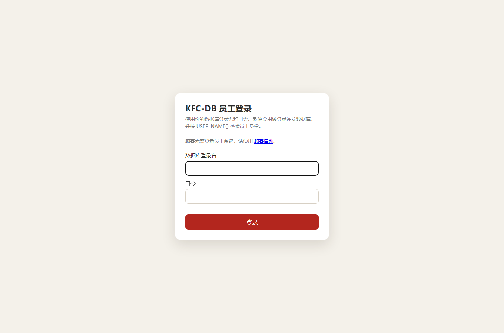

这是所有员工页面的入口，输入数据库登录名与口令。右侧另有"顾客自助"入口，顾客不从这里登录。截图未填写账号与口令。

**图 2 我的身份**（[`a-master-ui-02-identity`](../../../result/stage2/a-master-ui/a-master-ui-02-identity-2026-11-09.png)）

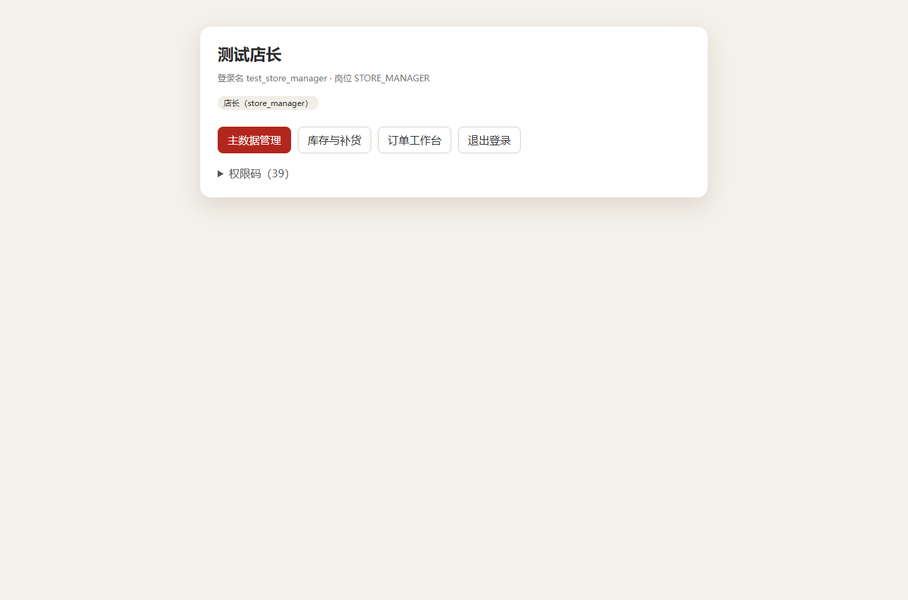

用 `test_store_manager` 登录后的身份页：岗位 `STORE_MANAGER`，库角色 `store_manager`。展开"权限码（39）"能看到该角色可调的 29 个过程与 10 个视图，下面四个入口分别是主数据、库存、订单工作台与退出。这一页证明身份与权限来自库里的授权，不是页面写死的菜单。

**图 3 主数据总览**（[`a-master-ui-03-master-index`](../../../result/stage2/a-master-ui/a-master-ui-03-master-index-2026-11-09.png)）

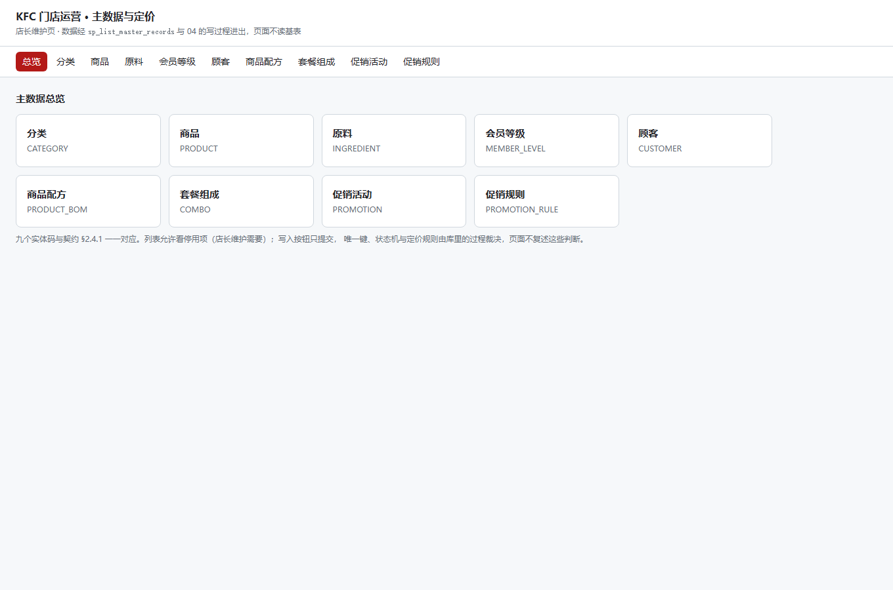

九个实体码排成卡片，与契约里的实体码一一对应；总览只做索引入口，不放写操作。它是后面九页的导航起点。

**图 4 分类**（[`a-master-ui-04-category`](../../../result/stage2/a-master-ui/a-master-ui-04-category-2026-11-09.png)）

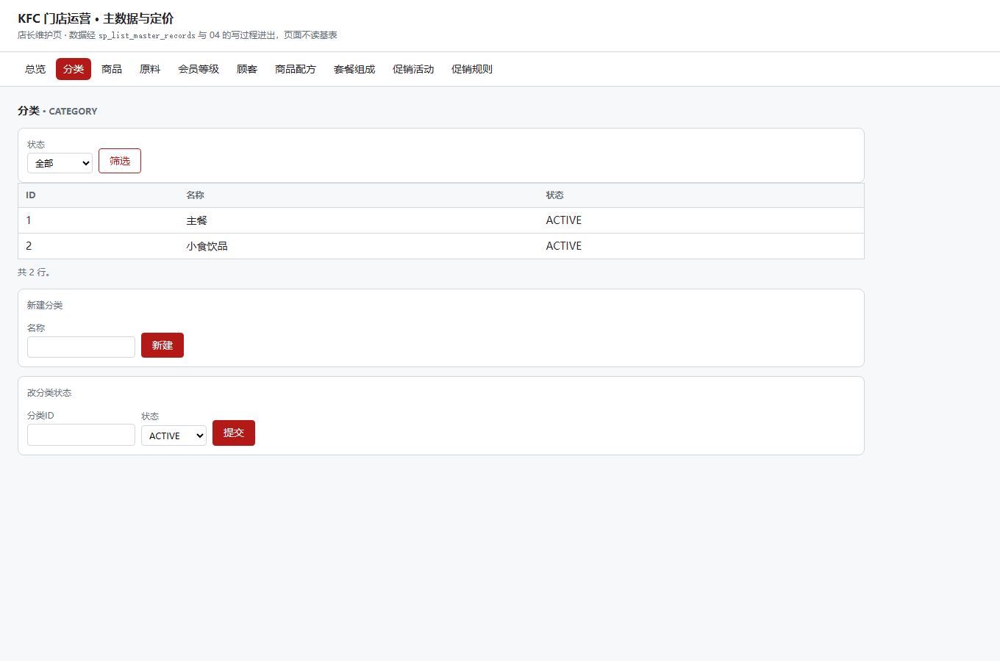

两条分类：主餐、小食饮品，均为启用。上方按状态筛选，下面两张表单是新建分类与改分类状态。分类页验证最简实体：两列数据、一个状态动作。

**图 5 商品**（[`a-master-ui-05-product`](../../../result/stage2/a-master-ui/a-master-ui-05-product-2026-11-09.png)）

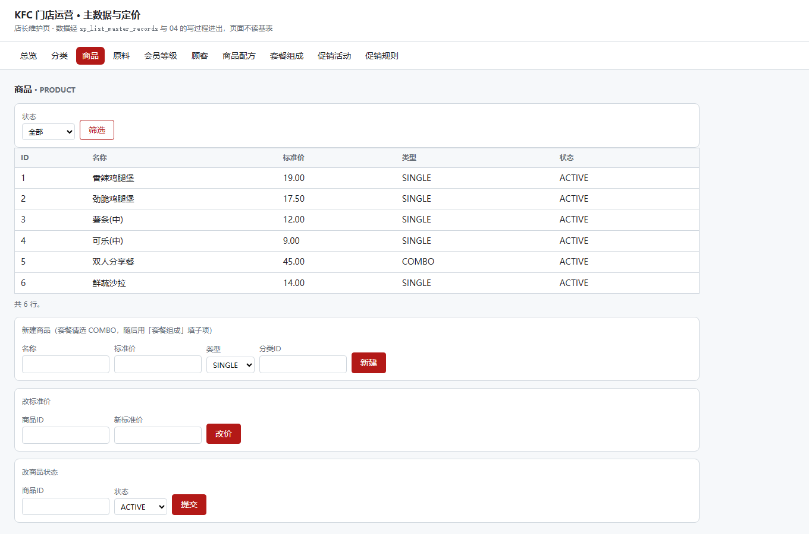

六件商品：香辣鸡腿堡 19.00、劲脆鸡腿堡 17.50、薯条（中）12.00、可乐（中）9.00、鲜蔬沙拉 14.00 是单品，双人分享餐 45.00 是 `COMBO`。三张表单分别是新建、改标准价、改状态。页面顶部那行说明是本轮新增的：取数经 `GET /api/master/product`、提交经 `POST /api/master/product/<action>`，该页是九页里唯一走 JSON 接口的。

**图 6 原料**（[`a-master-ui-06-ingredient`](../../../result/stage2/a-master-ui/a-master-ui-06-ingredient-2026-11-09.png)）

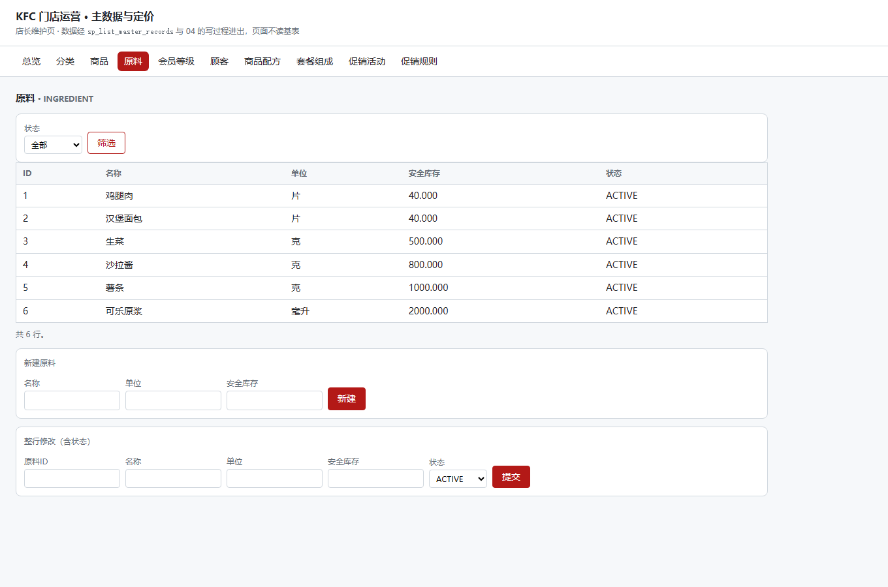

六种原料及单位、安全库存：鸡腿肉与汉堡面包各 40 片，生菜 500 克，沙拉酱 800 克，薯条 1000 克，可乐原浆 2000 毫升。安全库存是 C 的补货建议门槛，这里只维护数值；表单整行修改，含状态。

**图 7 会员等级**（[`a-master-ui-07-member-level`](../../../result/stage2/a-master-ui/a-master-ui-07-member-level-2026-11-09.png)）

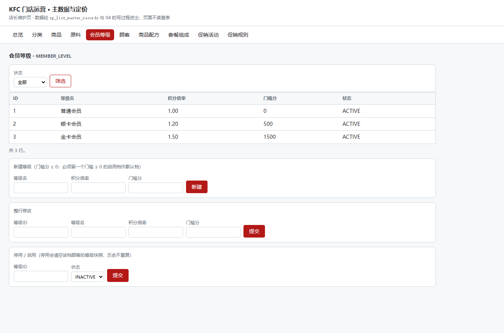

三档：普通 1.00 倍 / 0 分、银卡 1.20 倍 / 500 分、金卡 1.50 倍 / 1500 分。门槛唯一且至少要有一档门槛不高于 0 的启用等级作默认档，否则新建顾客取不到默认等级；停用某档会清空该档顾客的等级快照，历史积分不重算。

**图 8 顾客**（[`a-master-ui-08-customer`](../../../result/stage2/a-master-ui/a-master-ui-08-customer-2026-11-09.png)）

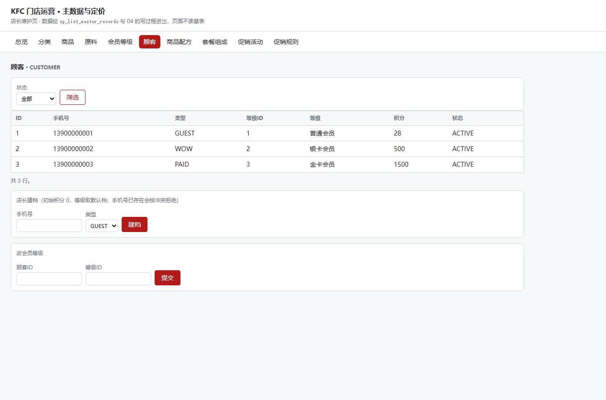

三条顾客：访客、`WOW` 会员、付费会员，等级分别为普通、银卡、金卡，积分 28 / 500 / 1500。店长建档时初始积分固定 0、等级取默认档；手机号已存在按冲突拒绝，不静默覆盖。

**图 9 商品配方**（[`a-master-ui-09-bom`](../../../result/stage2/a-master-ui/a-master-ui-09-bom-2026-11-09.png)）

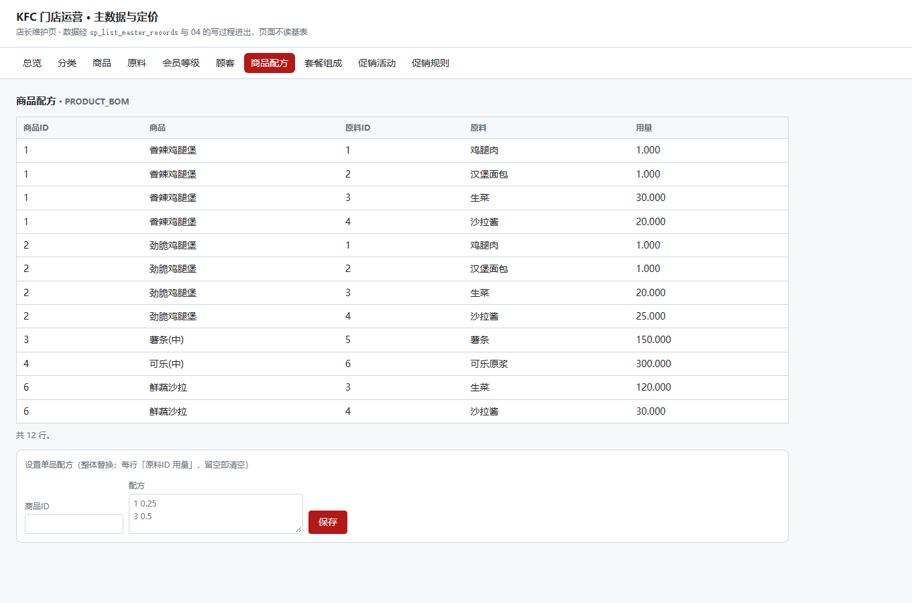

12 行配方：香辣鸡腿堡用鸡腿肉、汉堡面包各 1 份、生菜 30 克、沙拉酱 20 克；劲脆鸡腿堡生菜 20 克、沙拉酱 25 克；薯条（中）薯条 150 克；鲜蔬沙拉生菜 120 克、沙拉酱 30 克。配方整体替换，保存时按行提交，格式不对整批拒绝，不会留下写了一半的配方。

**图 10 套餐组成**（[`a-master-ui-10-combo`](../../../result/stage2/a-master-ui/a-master-ui-10-combo-2026-11-09.png)）

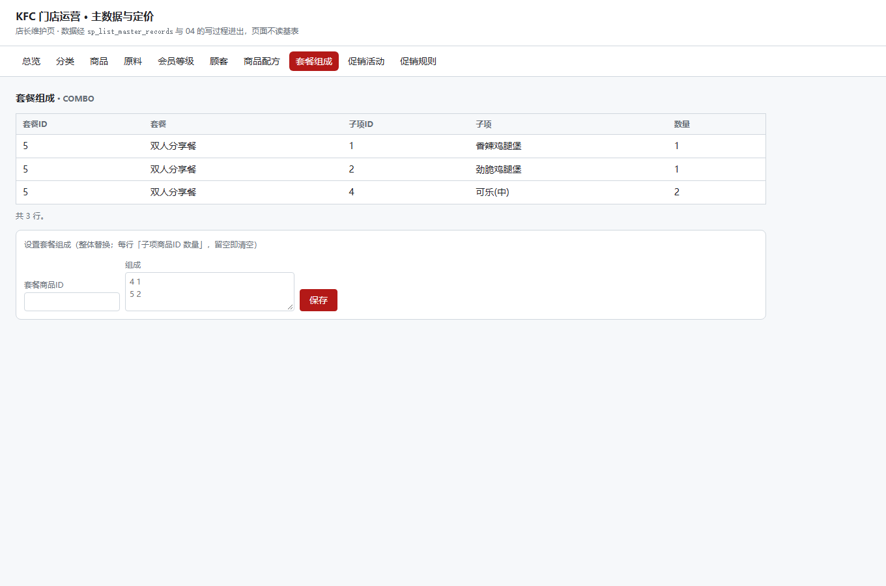

唯一套餐双人分享餐的三个子项：香辣鸡腿堡 1 份、劲脆鸡腿堡 1 份、可乐（中）2 份。收银只算套餐本身价格，配餐要展开到这些子项。

**图 11 促销活动**（[`a-master-ui-11-promotion`](../../../result/stage2/a-master-ui/a-master-ui-11-promotion-2026-11-09.png)）

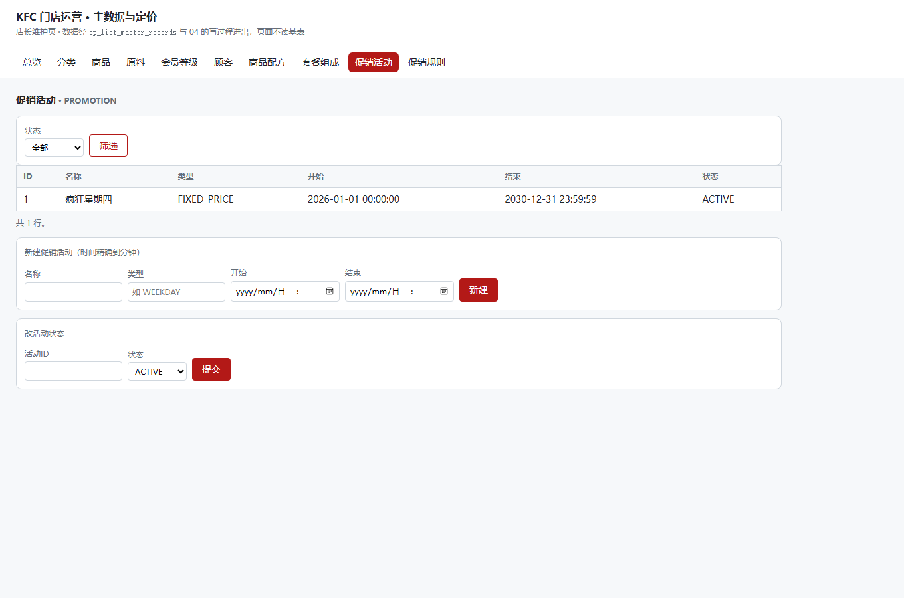

一个活动"疯狂星期四"，固定价类型，有效期 2026-01-01 至 2030-12-31。活动只定时间与状态，具体商品、星期、时段、价格在"促销规则"页配。

**图 12 促销规则**（[`a-master-ui-12-promotion-rule`](../../../result/stage2/a-master-ui/a-master-ui-12-promotion-rule-2026-11-09.png)）

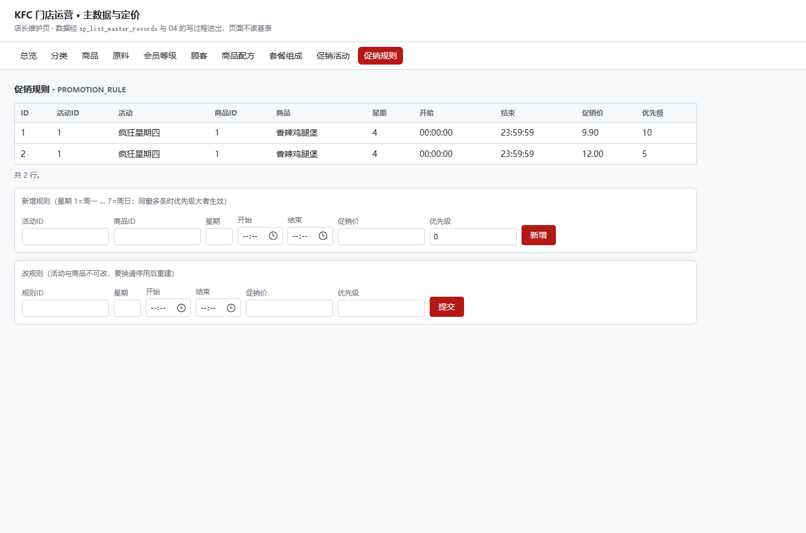

香辣鸡腿堡在星期三有两条规则：9.90 元优先级 10、12.00 元优先级 5。同一时间窗允许多档，取价按优先级从大到小选第一条，所以实际生效 9.90；`13a` 有同窗两档价的对应断言。

#### 2.6.2 B 域：同一笔订单走过六个岗位（8 张）

B 域的截图不是八个孤立页面，而是**同一笔自取单（订单 21）在不同岗位间的流转**，另用订单 18/19/20 演示取消与配送。步骤是：收银下单 → 收银收款 → 厨师开始制作 → 配餐完成制作 → 叫号看板显示待取餐 → 配餐确认自取；骑手与店长两页用另外的订单演示。

**图 13 员工登录**（[`b-orders-ui-01-login`](../../../result/stage2/b-orders-ui/b-orders-ui-01-login.png)）

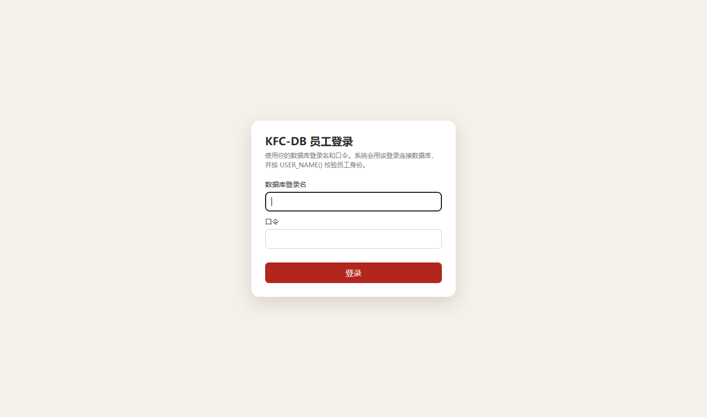

与 A 域共用同一个登录入口。B 的截图从这一页开始，之后分别用收银、厨师、配餐、服务员、骑手、店长账号登录，观察同一笔订单的可见性变化。

**图 14 收银下单**（[`b-orders-ui-02-cashier`](../../../result/stage2/b-orders-ui/b-orders-ui-02-cashier.png)）

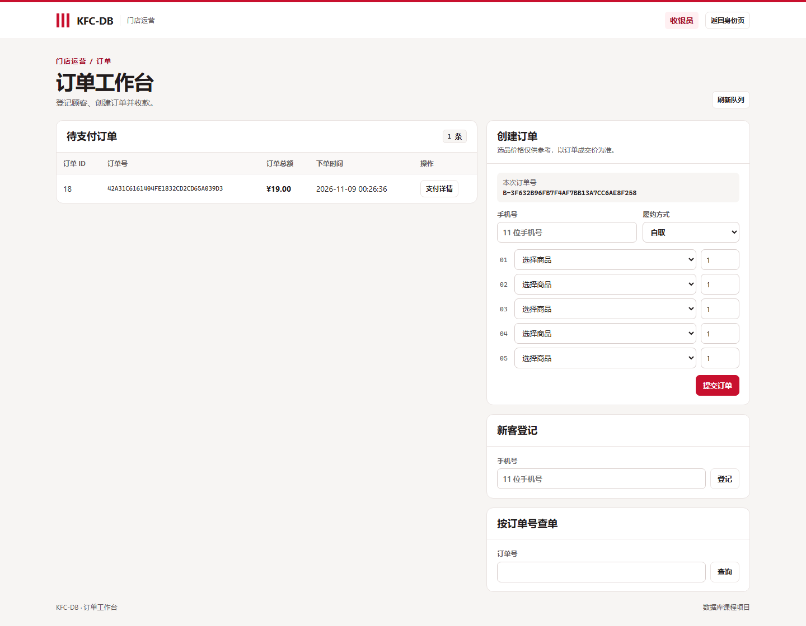

收银页左侧是待支付队列，右侧可登记新客、选品、下单、查单。填入手机号、选自取、选商品与份数；还没点"提交订单"时，表单已显示本次订单号——这是为"响应丢失后先查单、不换号重下"准备的。

**图 15 支付详情**（[`b-orders-ui-03-payment`](../../../result/stage2/b-orders-ui/b-orders-ui-03-payment.png)）

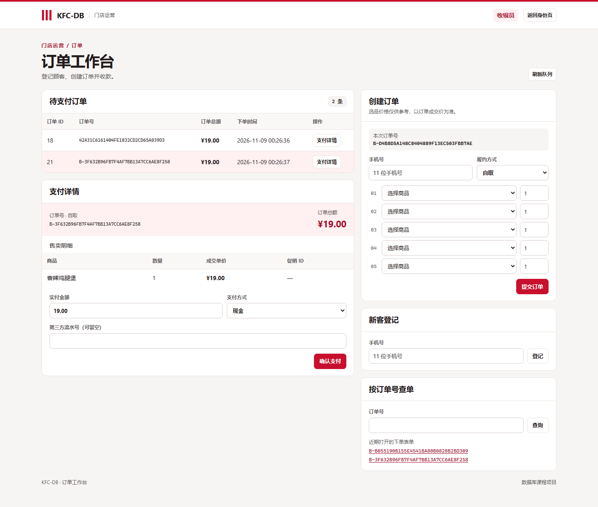

下单后订单 21 出现在待支付列表。点开支付详情：1 份香辣鸡腿堡，成交单价与总额都是 19.00，实付框带出 19.00；选现金支付、第三方流水号留空。这一步验证支付表单与订单头/售卖明细两块结果集的拼接。

**图 16 厨师队列**（[`b-orders-ui-04-chef`](../../../result/stage2/b-orders-ui/b-orders-ui-04-chef.png)）

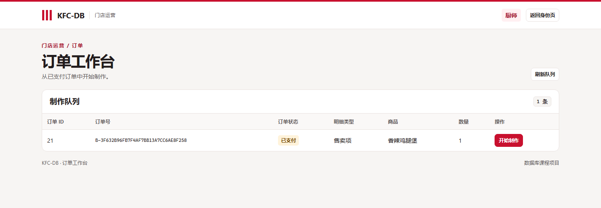

付款后换厨师账号，订单 21 状态"已支付"并出现"开始制作"。这说明支付提交后，岗位队列由订单状态实时派生，不需要另建 KVS 队列表。

**图 17 配餐队列**（[`b-orders-ui-05-packer`](../../../result/stage2/b-orders-ui/b-orders-ui-05-packer.png)）

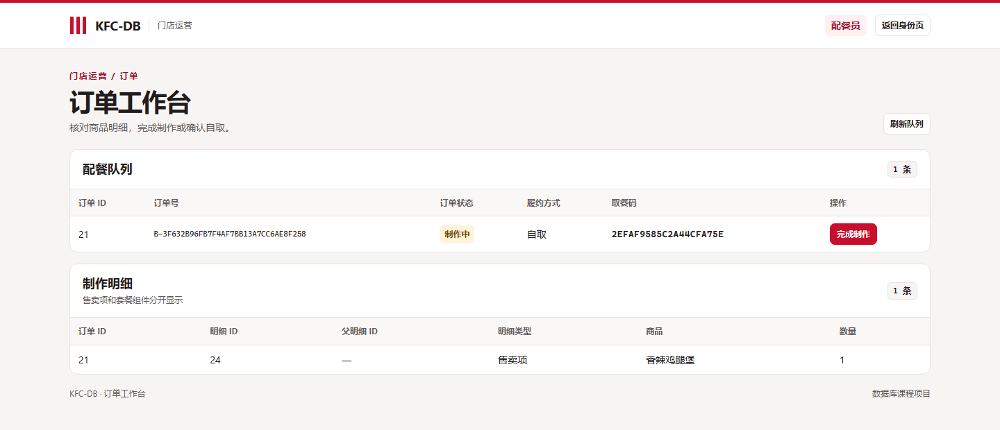

厨师开始制作后，配餐页显示"制作中"，上表是订单、下表是商品明细。这单是单品所以明细一行；若是套餐，下表还要展开组件。核对后点"完成制作"。

**图 18 取餐叫号**（[`b-orders-ui-06-waiter`](../../../result/stage2/b-orders-ui/b-orders-ui-06-waiter.png)）

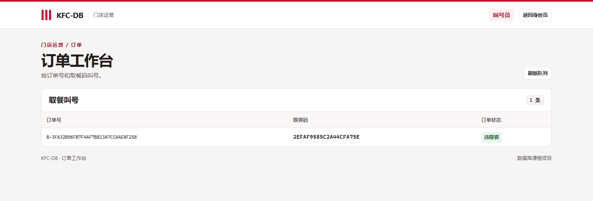

制作完成后订单 21 出现在叫号页，状态"待取餐"，取餐码与图 17 相同。该页只列订单号、取餐码与状态，服务员无写操作。

**图 19 骑手工作台**（[`b-orders-ui-07-rider`](../../../result/stage2/b-orders-ui/b-orders-ui-07-rider.png)）

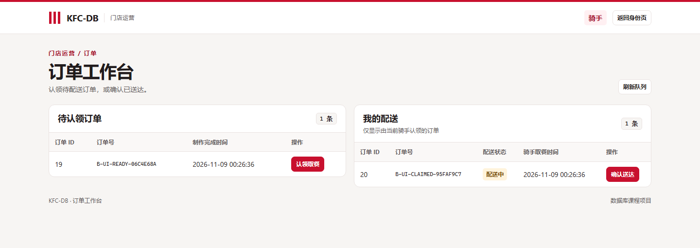

另两笔外送单：订单 19 做好后无人认领，列在左侧"待认领"；订单 20 已由当前骑手取餐，列在右侧"我的配送"，状态"配送中"，按钮是"确认送达"。这页验证骑手只能看到自己名下的配送单，待认领列表只给可接的单。

**图 20 店长工作台**（[`b-orders-ui-08-store-manager`](../../../result/stage2/b-orders-ui/b-orders-ui-08-store-manager.png)）

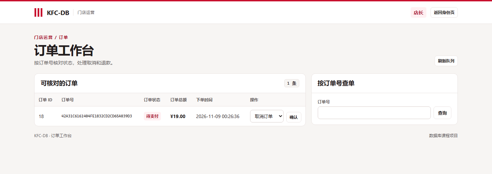

店长可按订单号查状态；左侧订单 18 尚未付款，所以同一行给出"取消"入口。已付款订单的退款用另一笔测试单在库里验证，图 20 没有演示退款——这个边界在 B 的报告里写明。

#### 2.6.3 C 域：库存、员工角色与顾客自助（7 张）

C 域的步骤分两段：先用店长账号看身份、库存看板与员工角色，再用顾客自助页走"建档 → 下自取单 → 用取餐码查单"。顾客这一段的关键是**同一次下单的订单号与取餐码必须能在查单页查回同一笔**。

**图 21 员工登录**（[`c-inventory-customer-ui-01-login`](../../../result/stage2/c-inventory-customer-ui/c-inventory-customer-ui-01-login.png)）

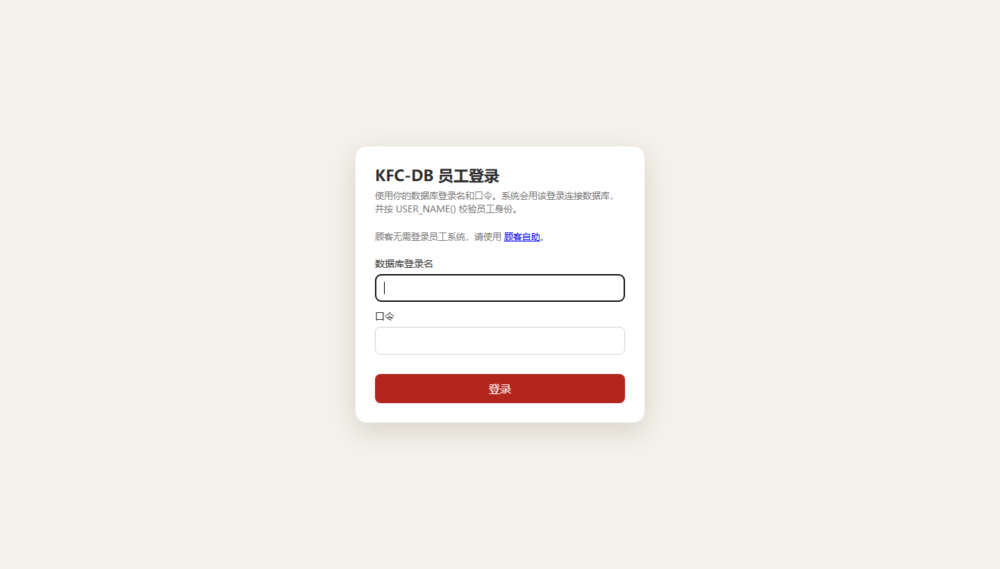

数据库登录入口，同时保留顾客自助入口。截图未填账号与口令。

**图 22 店长身份首页**（[`c-inventory-customer-ui-02-identity-store`](../../../result/stage2/c-inventory-customer-ui/c-inventory-customer-ui-02-identity-store.png)）

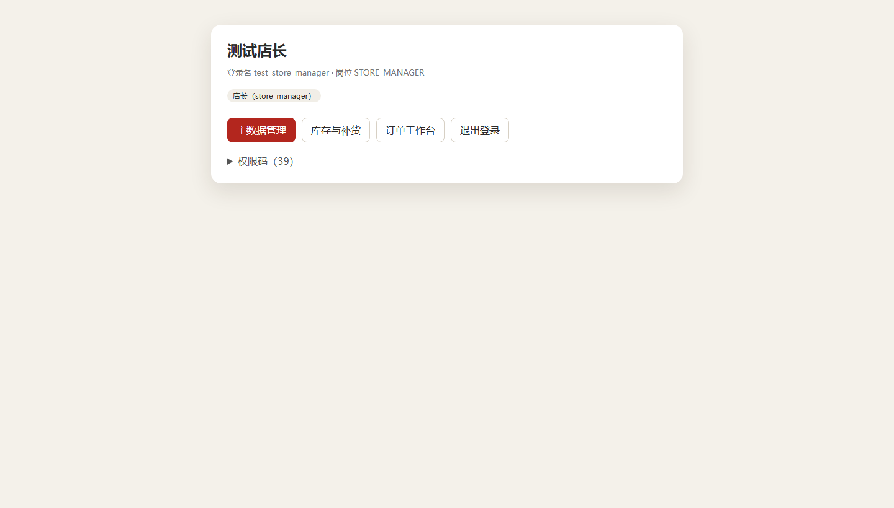

店长登录后的身份页：姓名、岗位、业务角色、权限码入口，以及主数据、库存、订单三个工作台入口。与 A 域图 2 是同一页，这里换的是 C 侧的临时登录与实例。

**图 23 库存看板**（[`c-inventory-customer-ui-03-inventory-dashboard`](../../../result/stage2/c-inventory-customer-ui/c-inventory-customer-ui-03-inventory-dashboard.png)）

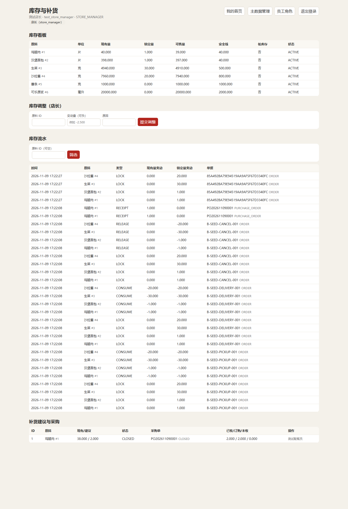

真实库存视图的现有量、锁定量、可售量与安全线，下面分库存调整、库存流水、补货建议/采购三块。数据来自种子和截图时的测试操作；可售量由 `on_hand − locked` 在视图里算，不落列。

**图 24 员工角色**（[`c-inventory-customer-ui-04-inventory-roles`](../../../result/stage2/c-inventory-customer-ui/c-inventory-customer-ui-04-inventory-roles.png)）

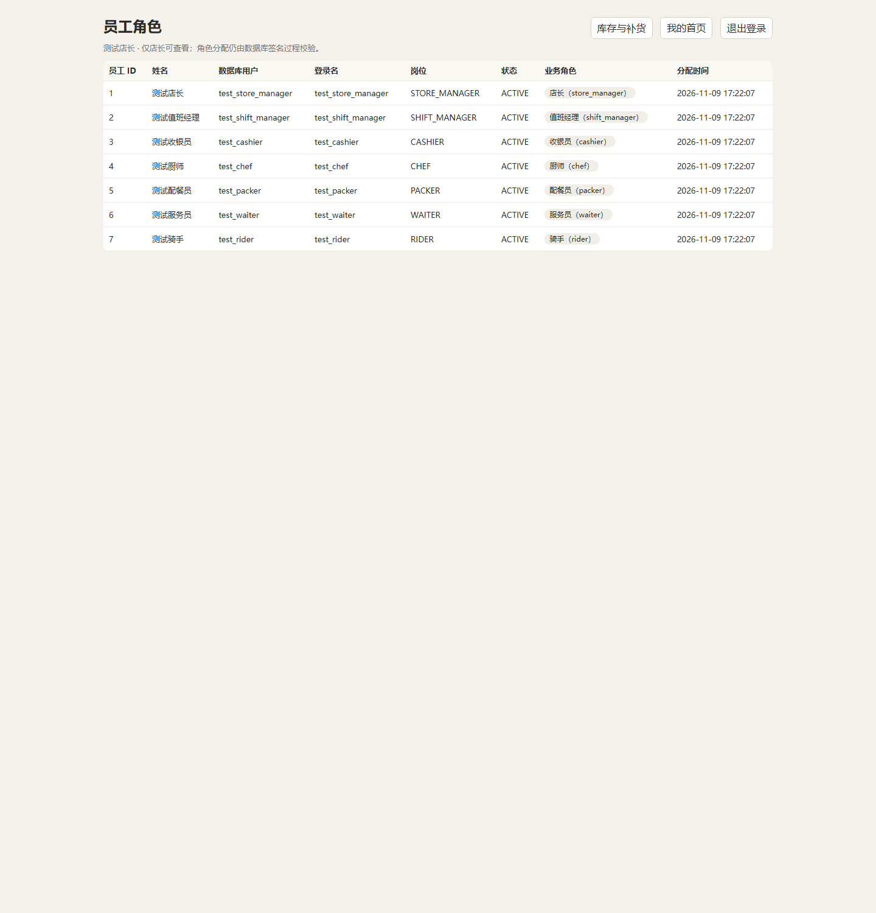

仅店长可读的员工角色页：员工、岗位、业务角色与分配时间。数据来自 `sp_list_employee_roles`，普通岗位调用会得到 `229`（`13c` 有对应断言）。

**图 25 顾客自助首页**（[`c-inventory-customer-ui-05-customer-home`](../../../result/stage2/c-inventory-customer-ui/c-inventory-customer-ui-05-customer-home.png)）

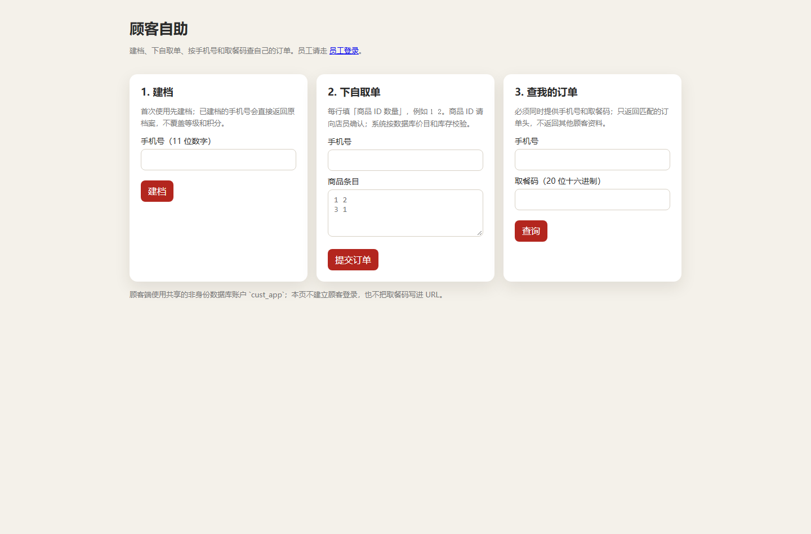

三个表单：建档、下自取单、按手机号加取餐码查单。顾客端不建立员工会话，只用 `cust_app` 调三个顾客过程。

**图 26 顾客下单结果**（[`c-inventory-customer-ui-06-customer-order`](../../../result/stage2/c-inventory-customer-ui/c-inventory-customer-ui-06-customer-order.png)）

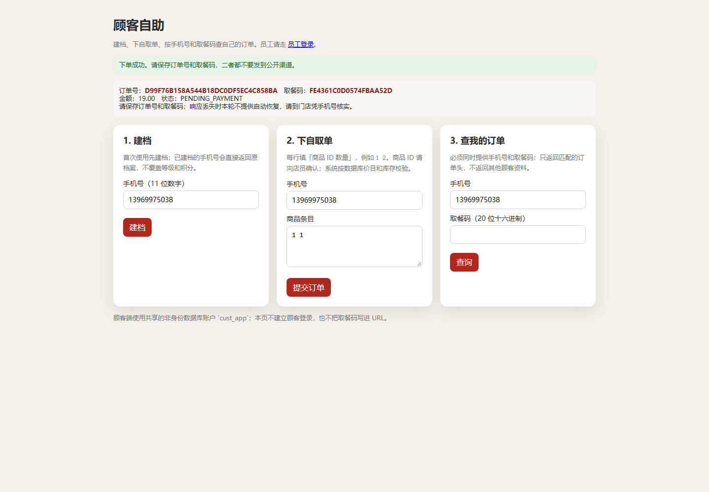

真实调用 `sp_customer_place_order` 后返回的订单号、取餐码、金额与状态。页面提示保存凭据并说明"响应丢失不自动重下"的边界；取餐码只经 POST 返回，不写进 URL。

**图 27 顾客查单**（[`c-inventory-customer-ui-07-customer-orders`](../../../result/stage2/c-inventory-customer-ui/c-inventory-customer-ui-07-customer-orders.png)）

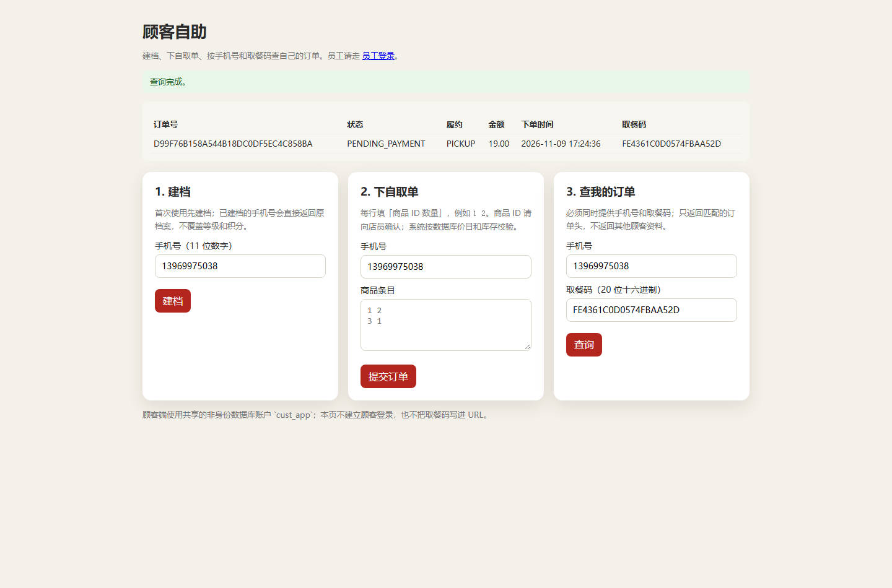

用同一手机号与图 26 的取餐码调用 `sp_customer_list_orders`，只查回匹配的订单头，看不到他人档案与员工资料。这一页与图 26 成对，证明"下单生成的凭据确实能查回同一笔"。

### 2.7 复现

迁移三步（仓库根目录）：

```powershell
sqlcmd -S localhost -E -C -f 65001 -b -i sql/stage2/capture_baseline.sql `
       -v SourceBaseline="<v0.1 提交号>" -v ConfirmAppStopped=YES
sqlcmd -S localhost -E -C -f 65001 -b -I -i sql/stage2/run_migration.sql
sqlcmd -S localhost -E -C -f 65001 -b -I -i sql/stage2/regression.sql
```

应用七套与真库两套：

```powershell
powershell -ExecutionPolicy Bypass -File tests/stage2/run-all.ps1 -Python .venv\Scripts\python.exe
.venv\Scripts\python.exe tests/stage2/inventory-security/run_inventory_security_tests.py
```

页面截图按各目录 README 的 `capture.py` 复跑：A 域见 [`result/stage2/a-master-ui/README.md`](../../../result/stage2/a-master-ui/README.md)，B 域见 [`b-orders-ui/README.md`](../../../result/stage2/b-orders-ui/README.md)，C 域见 [`c-inventory-customer-ui/README.md`](../../../result/stage2/c-inventory-customer-ui/README.md)。三份 README 都写了实例、账号、临时数据与"这组图不证明什么"。

## 3. 实验总结

### 3.1 结论

第二阶段的目标已经达成。数据库从 v0.1 在本机真实库上一次性迁移到 v1.0：15 个新过程、58 个权限码、71 行角色授权、3 个 `cust_app` 授权，迁移前后业务数据逐值对照 **0 差异**，提交后 `regression` **38/0**；应用层七个岗位加顾客端全部可用，七套应用测试 **118/0**，另有真库权限回归 15/0、顾客三过程 3/0、HTTP 冒烟 3/0。

具体来说：ER 图能完整表达 25 个实体与 35 条外键，图与库对得上；规范化只改了有证明的两处结构（`Permission` 拆分、采购单候选码）和五条候选码，其余保留项都有"为什么不拆"的论证；迁移链可以从任意已有 v0.1 库升级，失败整体回滚，不删库不重建；应用层所有写操作经同一套过程与同一套错误码，页面只做输入边界与编排；顾客端有独立身份与独立授权，不与员工权限混用。

### 3.2 主要设计取向

**先冻结，再实现。** ER 口径、规范化动作、跨域契约、访问层签名都在写代码前定稿，冻结清单直接变成迁移脚本的输入；实现中发现清单外的需求，先改清单再改脚本，不在迁移脚本里就地加约束。

**基线先行，逐值对账。** 迁移的第一件事不是改表，而是把 25 张表复制成快照并登记批次与摘要；摘要只定位，相等必须靠逐行逐列比较。这样"迁移有没有改坏数据"是一个可以重跑的问题，而不是靠抽样看一眼。

**一个外层事务，失败就回去。** `11a → 11b → 11c → 12` 全在一个事务里，门禁不通过就整体回滚；版本标记由迁移脚本在检查通过后写，不由操作者手工补。回滚的语义是回到 v0.1，不是删库重建。

**权限在数据库，不在页面。** 页面按角色隐藏按钮只是体验，真正的判定是 `GRANT` 与过程内的 `USER_NAME()` 校验；两者都拒绝时统一映射成"当前账号无权执行该操作"，不向用户泄露库内细节。

**应用薄、数据库厚。** 输入格式在 `service` 拦，业务规则在过程里判；不把库存、状态机、积分这些规则复制到 Python，也不让页面直接读基表。

**没有删除过程。** 商品、原料、分类、会员等级的"删除"是停用（`status = 'INACTIVE'`），订单是取消；全库没有 `sp_delete_*`。仅有的三处物理 `DELETE` 都在"整体替换/撤销"里（配方、套餐组成、员工角色撤销），同一事务先写审计快照。

**测试分母硬编码。** 每套测试的期望条数写死并当场核对，有 skip 也判失败；负例与正例同批跑，避免"只测了能走通的路"。

### 3.3 已知限制

- **正式登录部署未完成。** 员工与顾客的 SQL 登录需要操作者执行 `provision_employee.template.ps1` / `provision_customer.template.ps1` 并设置本机 `.env`；两个模板只做到语法解析与临时登录冒烟，真实口令不由仓库保存。顾客页目前输入商品 ID/数量——本轮没有面向顾客的商品目录过程，商品 ID 需向店员确认。
- **截图证明的是页面级取数，不是联合走查。** 三组截图都是 test client 取 HTML 后无头渲染，各域 README 都写明"不证明越权负例、并发、故障回滚或他人页面"。A/B/C 用真实浏览器做的三方联合验收仍待进行。
- **B 的页面验收记录独立。** B 的 11b 行为、并发、退款结论在 `result/stage2/b-order-acceptance-final.md`，C 只复核真实迁移、`13c`、`cust_app` 三过程与七套测试，不代签 B 的页面结论。
- **历史脚本可复跑性。** `result/stage2/scripts/` 下部分 B/C 校验脚本把仓库根写死成 `D:\DBLab\KFC-DB`，换机不能直接复跑（OI-20）；它们只是"当时如何得出结论"的溯源材料，输出已归档并登记哈希，不影响本轮结论。
- **接口层只覆盖 A 域。** `/api/master` 与页面共用 service，但只有商品页改为 fetch 取数与提交，其余实体页仍是服务端渲染；这是刻意保留的双路径，不是未完成项。
- **分析视图未开始。** 每日销售与经营汇总按数据边界清单属于派生聚合，留给后续阶段，避免在 OLTP 里手工维护。

### 3.4 后续

1. 操作者执行两个登录部署模板，A/B/C 用真实浏览器完成联合走查并回执；
2. 把顾客商品目录做成只读过程（当前顾客下单要人工确认商品 ID），同时保持 `cust_app` 只授三个过程的边界；
3. 经营分析视图与补货预测在 v1.0 结构上补，`InventoryMovement` 已按单据号留全流水；
4. 收尾核对数据字典、操作手册与 README 的 v1.0 数字一致（本轮已把七套 118/0 与 `/api` 同步进 README、操作手册与访问层契约）。

## 4. 证据索引

| 证据 | 位置 |
| --- | --- |
| 真实迁移、15 过程/3 GRANT/58 码/71 行、`regression` 38/0 | [`result/stage2/c-real-migration-2026-11-09.txt`](../../../result/stage2/c-real-migration-2026-11-09.txt) |
| 七套应用测试 118/0（`files=7`） | [`result/stage2/c-runall-final-2026-11-09.txt`](../../../result/stage2/c-runall-final-2026-11-09.txt) |
| 25 表基线采集与逐值对账 25/0 | [`result/stage2/c-real-capture-2026-11-03.txt`](../../../result/stage2/c-real-capture-2026-11-03.txt) |
| 迁移前后关键查询逐行对照（0 差异） | [`result/stage2/a-migration-compare/`](../../../result/stage2/a-migration-compare/) |
| 真库权限回归 `13c` 15/0 | [`result/stage2/c-inventory-security-2026-11-09.txt`](../../../result/stage2/c-inventory-security-2026-11-09.txt) |
| `cust_app` 三过程实调 3/0 | [`result/stage2/c-customer-custapp-2026-11-09.txt`](../../../result/stage2/c-customer-custapp-2026-11-09.txt) |
| HTTP 冒烟 3/0 | [`result/stage2/c-http-integration-2026-11-09.txt`](../../../result/stage2/c-http-integration-2026-11-09.txt) |
| 签名三路径 3/0 | [`result/stage2/c-signature-three-paths-2026-11-03.txt`](../../../result/stage2/c-signature-three-paths-2026-11-03.txt) |
| `11c` 回滚/提交证据 | [`result/stage2/c-11c-employee-roles-2026-11-05.txt`](../../../result/stage2/c-11c-employee-roles-2026-11-05.txt) |
| ER 总图核对 103 项 0 失败 | `result/stage2/stage2-model-check-2026-10-27.txt` |
| A 域 12 张运行截图 | [`result/stage2/a-master-ui/`](../../../result/stage2/a-master-ui/) |
| B 域 8 张运行截图 | [`result/stage2/b-orders-ui/`](../../../result/stage2/b-orders-ui/) |
| C 域 7 张运行截图 | [`result/stage2/c-inventory-customer-ui/`](../../../result/stage2/c-inventory-customer-ui/) |
| `/api/master` 实库探针 | [`result/stage2/a-api/`](../../../result/stage2/a-api/) |
| 测试汇总与边界 | [第二阶段测试报告](../test-report.md) |
| 成员实现细节 | [A](a-stage2-report.md)、[B](b-stage2-report.md)、[C](c-stage2-report.md) |
| 操作步骤与入口 | [操作手册](../user-manual.md) |

`result/` 下的证据文件都由 `.gitattributes` 的 `-text` 固定字节，SHA-256 登记在各目录 README 与 `result/README.md`。
