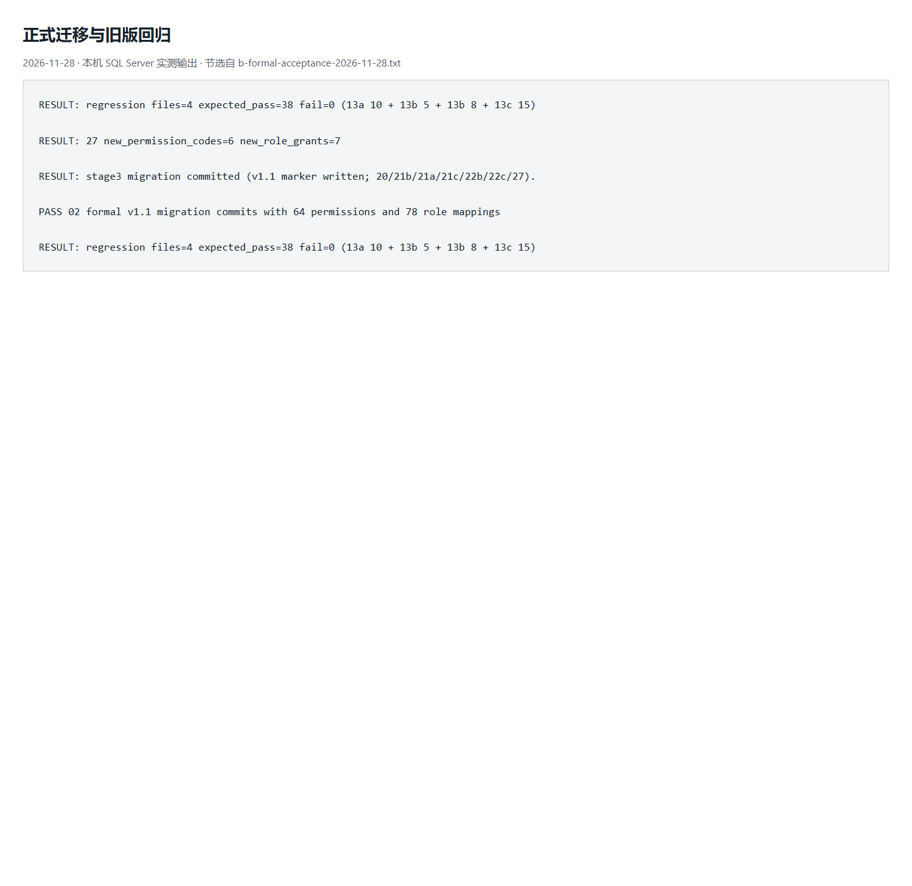
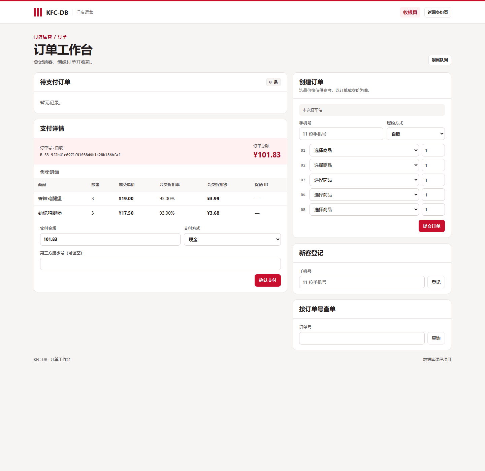
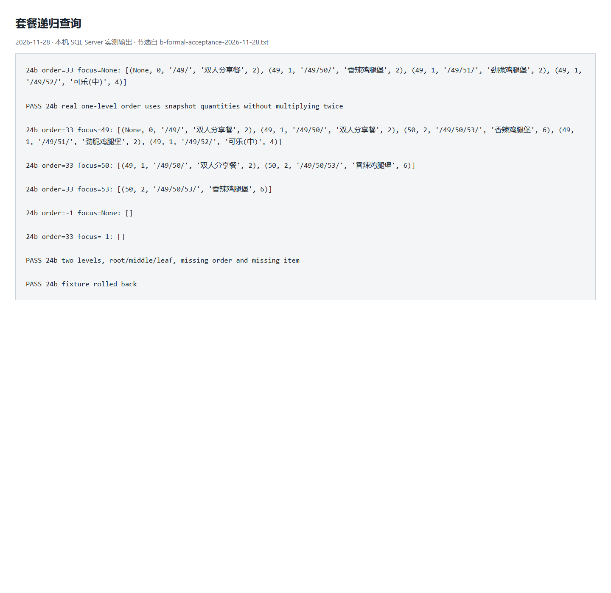
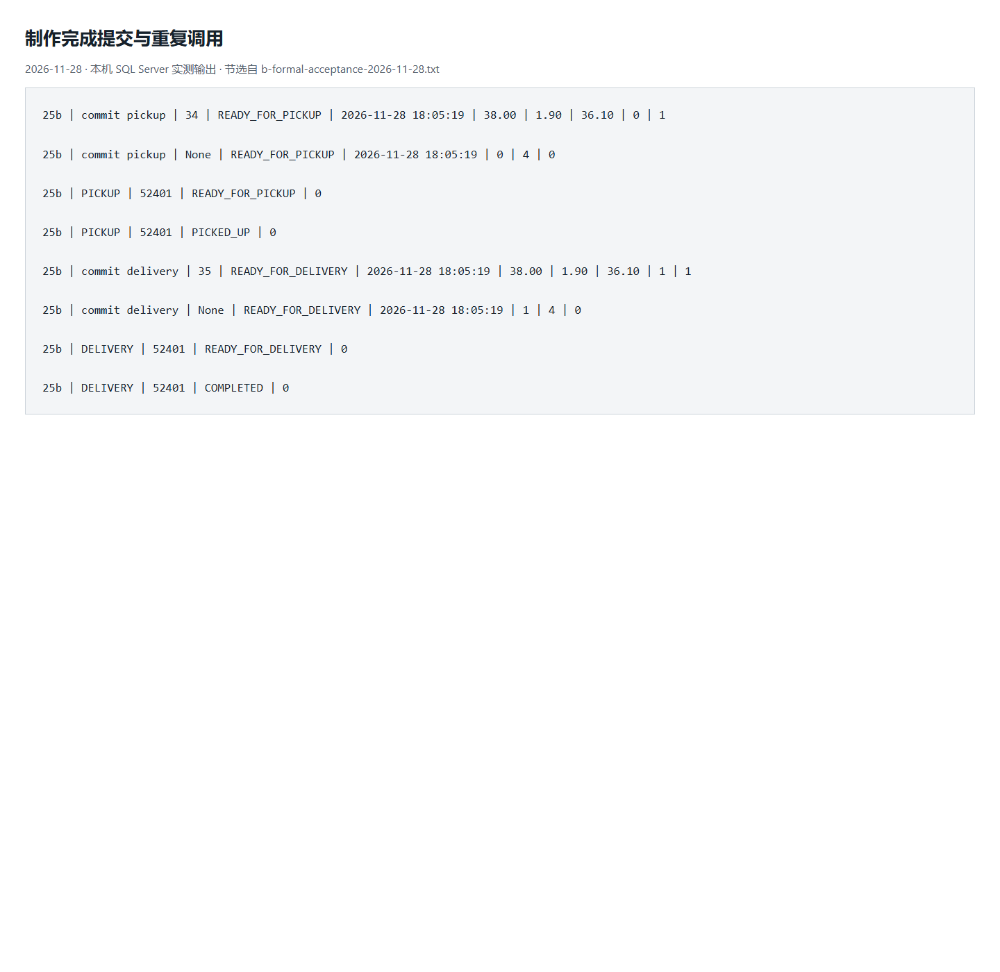
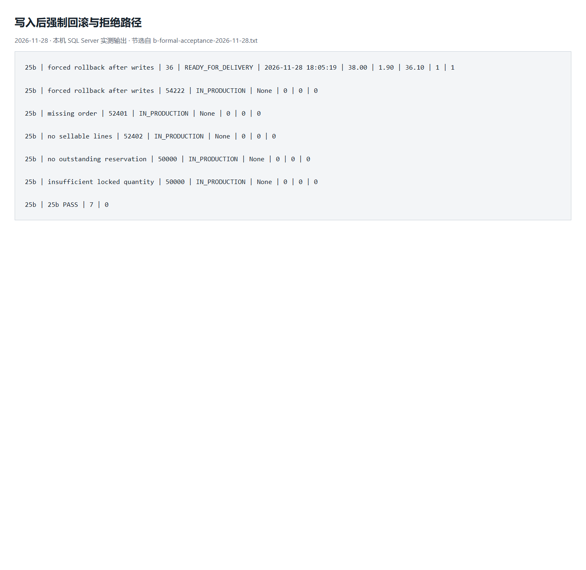
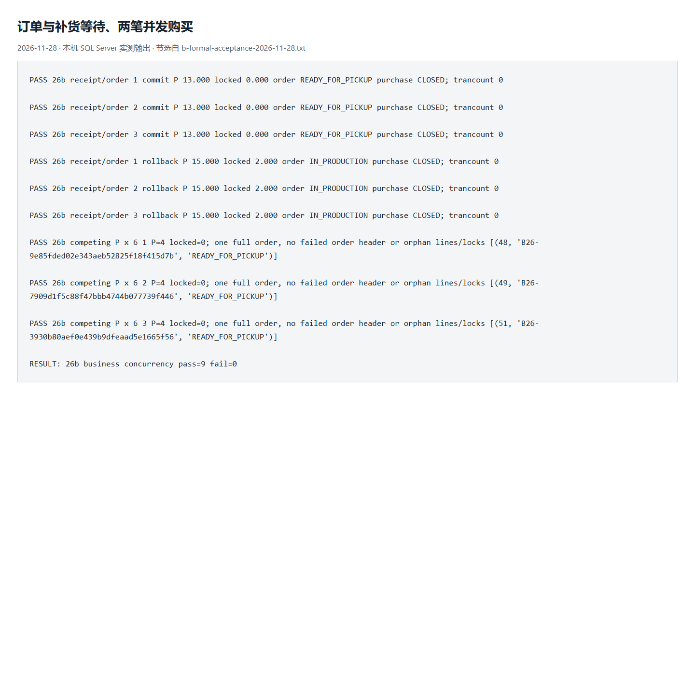
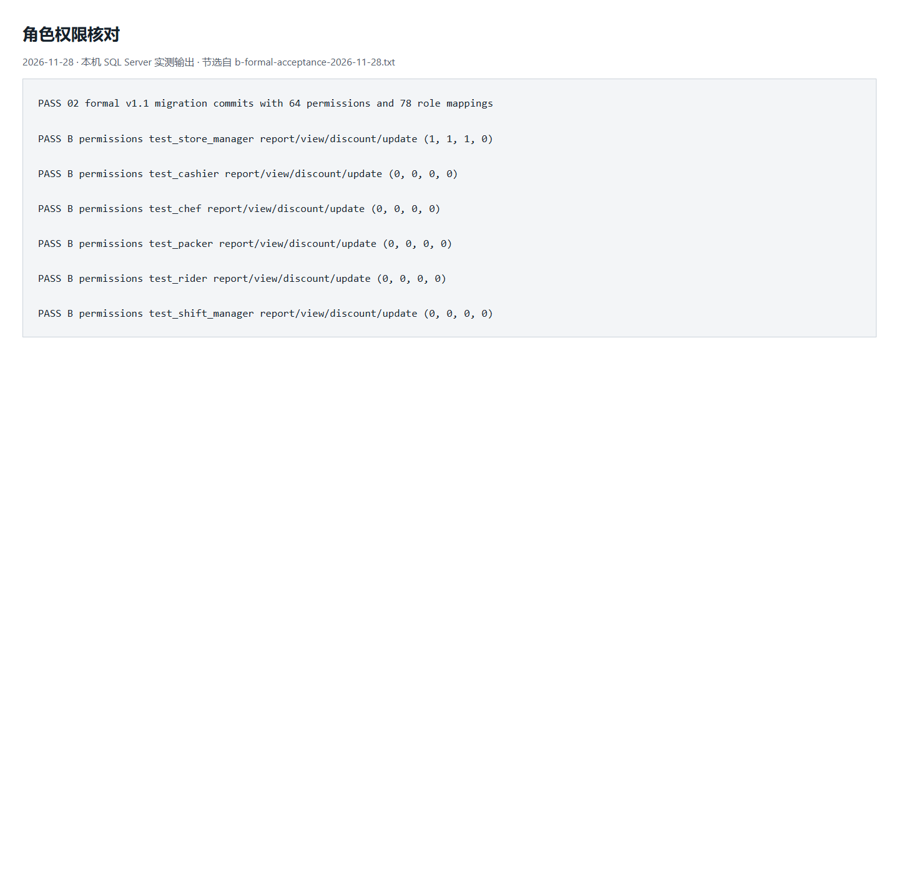
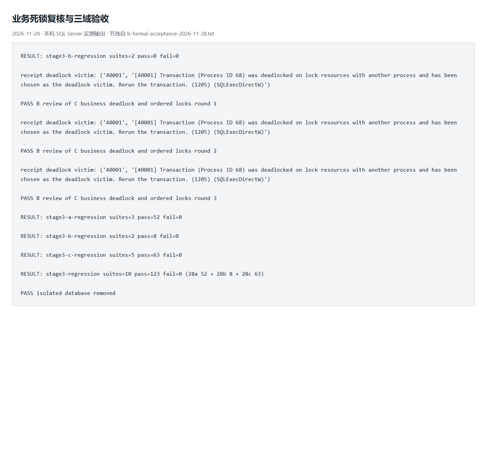

# 第三阶段个人实验报告（成员 B）

## 1. 实验任务

本阶段我负责订单侧的数据库编程。主要工作是在原有下单流程中保存会员折扣，编写销售统计过程、订单完成触发器、累计销售查询、套餐递归查询，再验证制作完成事务的提交、回滚和并发等待。

## 2. 实验思路

第二阶段已经能完成下单和履约，所以本次沿用原来的表和接口。价格仍由 A 的定价函数返回，库存仍调用 C 的过程。订单新增两列保存当时的折扣率和折扣额，之后查单直接读快照。这样商品价格、会员规则调整后，旧订单的金额仍有依据。

销售统计只读取已取餐和已送达的售卖明细。套餐的子项用于配餐，售价为零，不能再计入销售数量和收入。统计日期取完成时间，避免把还没有履约的订单算作销售。

## 3. 实验过程与结果

### 3.0 先跑正式迁移

11 月 28 日 C 的权限脚本到齐后，把 B 测试入口改为调用完整的 `run_stage3.sql`。之前单独安装域对象、手写版本标记的做法删除了。先从第一阶段种子部署 v1.0，再迁移到 v1.1，迁移前后各跑一遍旧 SQL 回归，都是 38 条通过。迁移后权限码 64 个，角色映射 78 条。



图1 中正式入口已经提交，版本标记由迁移脚本写入。两次 38 条回归分别对应升级前后。

### 3.1 保存折扣并核对金额

先写 `21b`，让员工下单和顾客下单都调用 A 的折扣函数。把订单折扣分摊到售卖明细后，逐行保存金额，再汇总得到订单总额。测试时用同一顾客和相同商品分别下单，两条路径得到相同折扣和总额。

还测了五件各 0.10 元的商品，共优惠 0.03 元的情况。这时逐行分摊会有分币尾差，最终应恰好三行各优惠 0.01 元。测试核对了每行金额和整单合计。

收银支付详情增加会员折扣率和折扣额两列。显示值来自支付查询结果，实付默认值仍取订单总额。旧版查询没有这两列时，页面继续显示原有内容。迁移前留下的零折扣率用横线显示，避免让人误以为整行商品免费。



图2 使用本次查询到的订单数据渲染工作台。两种汉堡各 3 份，会员折扣率均为 93%，两行优惠分别为 3.99 元和 3.68 元，订单实付 101.83 元。

### 3.2 校验订单完成并统计销售

`22b` 的触发器在完成状态变更时检查明细、数量、金额和实扣流水。测试不仅更新一行，还一次更新两笔订单。其中一笔金额不对时，整次更新被拒绝，两笔订单都维持原状态。

累计查询 `23b` 先按完成日期汇总净额，再用窗口函数计算累计值。测试核对每日只有一行，最后一天累计值与销售明细总额相同。日期边界用跨午夜的两笔订单检查，避免运行当天不同导致结果变化。

### 3.3 展开套餐明细

`24b` 使用订单明细的父项编号递归查询。第一次用两份双人分享餐测试，根项数量为 2，两个汉堡子项分别为 2，可乐子项为 4。这里发现子项在下单时已经乘过父项数量，查询时再乘一次就会算错。

为了验证递归不只支持一层，在回滚事务里临时加了第二层。分别查询整棵树、中间节点、叶子和不存在的编号，逐项比较父项、路径、层级和数量。应用目前仍限制套餐嵌套，这组数据只用于验证查询，结束后全部回滚。



图3 依次给出整单、根节点、中间节点、叶子和不存在编号的结果。路径中的编号对应父子关系，不存在的编号返回空集合。

### 3.4 验证制作完成事务

`25b` 先通过测试岗位实际完成下单、付款和开始制作，再进入实验事务。制作完成后检查订单状态和时间，逐项比较原料现有量、锁定量和 `CONSUME` 流水。自取不产生配送记录，外送产生一条待认领记录。

提交路径完成后重新查库，确认结果已保存。回滚路径在制作完成成功后主动抛错，再检查订单恢复为制作中，完成时间清空，库存和流水恢复，新增配送记录消失，事务数为零。



图4 中自取和外送分别进入待取餐、待配送。第二次制作完成返回 52401，订单继续履约至终态后再调用也被拒绝。



图5 先显示事务内已经写入制作完成时间，再注入 54222 错误。回滚后状态恢复为制作中，时间为空，配送和实扣流水均为 0，事务数也为 0。

共测试 7 个场景。重复制作完成返回 `52401`，没有预留量或锁定量不足返回 `50000`。测试还发现缺少售卖明细但保留锁库流水时，原过程仍可扣库存，因此在 B 的 v1.1 迁移中补了明细校验，返回 `52402`。后续实际取餐和送达也做了核对，库存没有再次扣减。

### 3.5 观察订单完成的并发等待

用两个独立连接做实验。第一个连接以店长身份调整库存，外层事务暂不结束。第二个连接以配餐员身份完成同一原料对应的订单。观察连接通过 DMV 读取等待类型和阻塞会话号。

等待后继续和等待超时各重复三轮。每次都抓到 `LCK_M_S`，阻塞会话号指向店长连接。第一种在释放店长事务后完成制作。第二种设置 1500 毫秒等待上限，三轮均收到 `1222`，耗时约 1.5 秒。

DMV 此次抓到的是 KEY 资源上的共享锁等待，不能仅凭等待类型认定具体卡在库存更新语句。能够确认的是，库存调整事务尚未结束时，真实订单完成调用会受阻。测试没有改动 C 的锁顺序，也没有另造死锁场景。两边回滚后比较库存、订单、配送、流水、补货建议和审计等八张表，数据与实验前一致。

### 3.6 按第十三周要求补业务并发

11 月 25 日同步新版计划后，增加 `26b`，将订单完成与真实采购收货放到两个连接中。初始 P=10，订单购买 2 件，制作完成后先保持事务。补货连接对 P 收货 5 件，观察连接记录到它在等待订单连接。

订单提交后，补货继续，最后 P=13；重置夹具，改为订单回滚，最后 P=15。回滚轮订单仍在制作中，原来锁定的 2 件也恢复，因此这里现有量是 15，可售量是 13。两种情况各运行三轮，采购单都完成收货并关闭。

再把 P 设为 10，两笔不同订单同时买 6 件。每笔订单的下单、付款、开始制作和完成制作放进同一外层事务。每轮只有一笔成功，另一笔收到库存不足错误，最后 P=4，锁定量为 0。检查订单头只保留成功单，对应原料也只留一组锁定和消耗流水。这项重复三轮通过。

这些实验在 11 月 28 日正式 v1.1 上重新执行，仍为九轮通过。



图6 分别记录提交、回滚和竞争购买的最终值。回滚轮的锁定量恢复为 2，所以库存现有量 15 对应的可售量为 13。

### 3.7 联合验收

同步 A、C 最新提交后，B 的测试入口增加 `--verify-all`，实际调用 C 的汇总入口。`28a` 通过 52 条，`28b` 通过 8 条，`28c` 通过 63 条，合计 123 条。第二阶段 SQL 回归仍为 38 条通过，七套应用测试共 118 条通过。

11 月 28 日已使用正式迁移入口和权限完成上述验收。第二阶段七套应用为 118 条通过，A 报表应用 9 条通过，C 应用 8 条通过。实验结束后已删除测试库。

### 3.8 复核角色权限与业务死锁

按正式角色矩阵检查六个测试岗位。店长具有销售报表、已结算视图和折扣函数权限，其他五个岗位直接调用销售报表时返回 229。六个业务账号都没有直接更新订单表的权限。下单过程仍可通过既有接口调用折扣函数，收银业务测试通过。



图7 每个四元组依次表示报表执行、销售视图读取、折扣函数读取和订单表更新权限，1 表示允许，0 表示拒绝。

复用 C 已交付的真实业务脚本，反向锁定和同序锁定各运行三轮。反向轮每次都捕获补货事务的 1205，订单事务继续完成。改为先按原料编号依次锁 P、Q 后，两端正常完成，允许普通等待。每轮三个连接事务数都是 0。



图8 的三条 1205 来自反向锁定轮，三个 PASS 对应每轮反向与改进对照均通过。最后是三域 123 条回归和隔离库清理结果。

## 4. 实验体会

这次最容易出错的是把不同阶段的数据混在一起。套餐子项已经展开，查询就应该读取快照。制作完成已经扣过库存，取餐和送达就要检查不会重复扣。只看到过程执行成功也不够，回滚测试需要在写入后制造错误，再逐项比较恢复结果。

## 5. 复跑与证据

在仓库根目录运行下面的命令，会创建隔离库、执行专项与联合验收、完成六轮并发实验，最后清理测试库。

```powershell
.venv/Scripts/python.exe -X utf8 tests/stage3/b_programmability/run_b_stage3.py --sql-server 'localhost\MSSQLSERVER2' --verify-all --concurrency-v2 --review-c
```

`--concurrency-v2` 覆盖 P=13、15、4 的九轮结果，`--review-c` 复跑 C 的业务死锁与同序锁定。`--concurrency` 保留前期库存调整等待实验。

- [本次完整运行输出](../../../result/stage3/b-final-verification-2026-11-24.txt)
- [递归与事务输出](../../../result/stage3/b-24b-25b-2026-11-18.txt)
- [接口与集成交接](../../../result/stage3/b-integration-handoff-2026-11-24.md)
- [正式 v1.1 完整验收](../../../result/stage3/b-formal-acceptance-2026-11-28.txt)
- [本轮收尾与权限回执](../../../result/stage3/b-closeout-2026-11-28.md)

图2 是真实 SQL 返回数据对应的 Flask 模板截图。其余七张是本轮 SQL 运行日志节选的浏览器展示截图，保留完整原始日志供核对。全部八张均为本机 Edge 实际截图。
